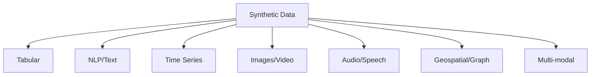
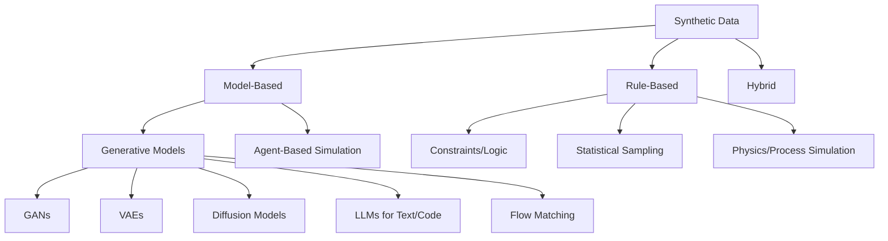
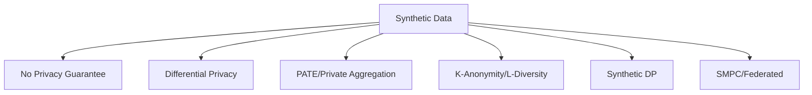
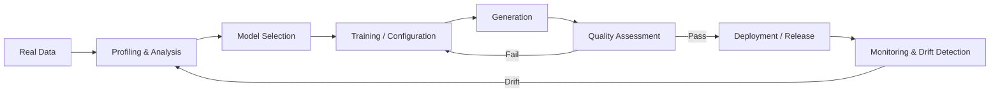

# Synthetic Data Fundamentals

A comprehensive reference for synthetic data concepts, terminology, taxonomies, and foundational knowledge.

---

## 1. What is Synthetic Data?

**Definition**: Synthetic data is artificially generated data that mimics the statistical properties, patterns, and relationships of real-world data without containing any actual real records.

```markdown
Synthetic Data ≠ Fake Data
├── Fake Data: Random, meaningless, no statistical fidelity
├── Synthetic Data: Statistically faithful, preserves distributions/correlations
└── Anonymous Data: Real data with identifiers removed (still real data)
```

### Key Characteristics
| Property | Description |
|----------|-------------|
| **Statistical Fidelity** | Preserves marginal/joint distributions, correlations |
| **No Real Records** | Zero overlap with training/source data |
| **Generative** | Produced by a model/process, not collected |
| **Controllable** | Parameters tune distribution, bias, fairness |
| **Scalable** | Generate arbitrary volume on demand |

---

## 2. Synthetic Data Taxonomy

### 1. By Data Modality


### 2. By Generation Approach


### 3. By Privacy Guarantee


---

## 2. Core Concepts & Terminology

| Term | Definition |
|------|------------|
| **Fidelity** | Statistical similarity between synthetic and real data |
| **Utility** | Downstream task performance (ML accuracy, statistical validity) |
| **Privacy** | Risk of re-identification / attribute inference |
| **Fidelity-Utility-Privacy Tradeoff** | Fundamental tension: higher fidelity → higher privacy risk |
| **Fidelity Metrics** | Statistical distance (KS, JS, Wasserstein), correlation preservation |
| **Utility Metrics** | Downstream task performance (ML accuracy, statistical test power) |
| **Privacy Metrics** | Re-identification risk, attribute inference, membership inference |
| **Fidelity-Privacy Frontier** | Pareto frontier of achievable (fidelity, privacy) pairs |

---

## 3. Synthetic Data vs. Alternatives

| Approach | Data Access | Privacy | Utility | Scalability | Use Case |
|----------|-------------|---------|---------|-------------|----------|
| **Raw Data** | Full | None | Maximum | Limited | Gold standard |
| **Anonymization** | Reduced | Medium | Medium | High | Legacy compliance |
| **Differential Privacy** | Query-only | High (ε) | Reduced | Medium | Query release |
| **Federated Learning** | Distributed | High | High | Complex | Cross-silo ML |
| **Synthetic Data** | Full synthetic | Tunable | High | High | Dev, test, ML, sharing |
| **Secure Multi-Party** | Distributed | High | High | Complex | Multi-party analytics |

---

## 3. Quality Dimensions (The "FUP" Triangle)

```
                    FIDELITY
                       /\
                      /  \
                     /    \
              PRIVACY----UTILITY
```

| Dimension | What it Measures | Key Metrics |
|-----------|------------------|-------------|
| **Fidelity** | Statistical similarity to real data | KS distance, JS divergence, correlation preservation, MMD |
| **Utility** | Downstream task performance | ML accuracy, statistical test power, coefficient recovery |
| **Privacy** | Re-identification risk | Membership inference, attribute inference, k-anonymity |

---

## 4. Generation Paradigms Compared

| Paradigm | Pros | Cons | Best For |
|----------|------|------|----------|
| **GANs** | High fidelity, flexible | Training instability, mode collapse | Images, tabular (CTGAN, TVAE) |
| **VAEs** | Stable training, latent space | Blurry outputs, lower fidelity | Anomaly detection, semi-supervised |
| **Diffusion** | High quality, stable | Slow sampling, compute-heavy | Images, audio, high-fidelity |
| **Normalizing Flows** | Exact likelihood, invertible | Limited expressivity | Density estimation |
| **Normalizing Flows** | Exact likelihood | Architecture constraints | Density estimation |
| **Diffusion + GAN** | Best of both | Complex | State-of-art images |
| **LLMs (Tabular/Text)** | Flexible, conditional | Hallucination, slow | Text, code, conditional tabular |
| **Bayesian Networks** | Interpretable, causal | Structure learning hard | Causal inference, domain knowledge |
| **Copulas** | Marginals + dependence | Marginal assumption | Financial, risk modeling |
| **Agent-Based** | Mechanistic, causal | Calibration effort | Simulation, policy testing |

---

## 4. Key Mathematical Concepts

### Statistical Distance Metrics
```python
# Common fidelity metrics
from scipy.stats import ks_2samp, wasserstein_distance
from scipy.spatial.distance import jensenshannon
import numpy as np

# Kolmogorov-Smirnov (1D)
ks_stat, p_val = ks_2samp(real_data, synthetic_data)

# Jensen-Shannon Divergence
jsd = jensenshannon(p_real, p_synth)

# Wasserstein Distance (Earth Mover's Distance)
emd = wasserstein_distance(real_data, synthetic_data)

# Maximum Mean Discrepancy (MMD)
from sklearn.metrics import pairwise
mmd = mmd_rbf(real_data, synthetic_data)

# Correlation Preservation
corr_real = np.corrcoef(real_data.T)
corr_synth = np.corrcoef(synth_data.T)
corr_diff = np.abs(corr_real - corr_synth).max()
```

### 2. Utility Evaluation
```python
# Train on synthetic, test on real (TSTR)
def train_synthetic_test_real(synth_gen, real_train, real_test, model_class, **kwargs):
    synth_data = synth_gen.generate(len(real_train))
    model = model_class().fit(synth_train.X, synth_train.y)
    return evaluate(model, real_test.X, real_test.y)

# Test on synthetic, train on real (TRTS)
def train_real_test_synthetic(real_train, synth_test, model_class):
    model = model_class().fit(real_train.X, real_train.y)
    return evaluate(model, synth_test.X, synth_test.y)
```

### 3. Privacy Metrics
```python
# Membership Inference Attack
def membership_inference_attack(model, train_data, test_data, synthetic_data):
    # Train attack model to distinguish train vs synthetic
    pass

# Attribute Inference
def attribute_inference(synthetic_data, target_col, known_cols):
    # Can we infer sensitive attribute from synthetic?
    pass

# k-Anonymity Check
def check_k_anonymity(df, quasi_identifiers, k=5):
    grouped = df.groupby(list(quasi_identifiers)).size()
    return (grouped >= k).all()
```

---

## 5. Synthetic Data Lifecycle



### Generation Pipeline
```python
class SyntheticDataPipeline:
    def __init__(self):
        self.profiler = DataProfiler()
        self.model = None
        self.validator = QualityValidator()
    
    def fit(self, real_data):
        # 1. Profile
        self.profile = self.profiler.profile(real_data)
        
        # 2. Select model
        self.model = self.select_model(self.profile)
        
        # 3. Train
        self.model.fit(real_data)
        
        # 3. Generate
        synthetic = self.model.sample(n_samples)
        
        # 4. Validate
        report = self.validator.validate(real_data, synthetic)
        
        if not self.passes_thresholds(report):
            return self.iterate(real_data)
        
        return synthetic
```

---

## 5. Common Pitfalls & Anti-Patterns

| Pitfall | Symptom | Solution |
|---------|---------|----------|
| **Mode Collapse** | GAN generates limited variety | Use minibatch discrimination, unrolled GAN, PacGAN |
| **Overfitting to Real Data** | Memorization, privacy leaks | Regularization, DP, early stopping |
| **Distribution Shift** | Covariate shift in deployment | Domain adaptation, importance weighting |
| **Label Leakage** | Target leaks into features | Strict feature/target separation |
| **Temporal Leakage** | Future info in training | Strict temporal splits |
| **Categorical Explosion** | Too many one-hot columns | Embedding, target encoding |
| **Imbalanced Classes** | Rare classes underrepresented | Stratified sampling, SMOTE, focal loss |
| **Temporal Inconsistency** | Future leaks into past | Strict temporal splits, sliding windows |
| **Causal Violations** | Impossible feature combinations | Causal constraints, SCM |
| **Privacy Leakage** | Reconstruction attacks | DP, PATE, synthetic DP |

---

## 5. Quick Reference Card

| Need | Start Here |
|------|------------|
| **Quick tabular synthesis** | `sdv.single_table.GaussianCopulaSynthesizer` |
| **Complex tabular (mixed types)** | `sdv.single_table.CTGANSynthesizer` or `synthcity` |
| **Time series** | `synforecast`, `nf.ts` |
| **Privacy (DP)** | `dp-sgd`, `opacus`, `dp-synthetic` |
| **Text/NLP** | `LangChain` + `Faker`, `Gretel`, `LLM` fine-tune |
| **Images** | `Stable Diffusion`, `ControlNet`, `Diffusion` |
| **Time Series** | `neuralforecast`, `statsforecast`, `syntheticts` |
| **Evaluation** | `sdv.evaluation`, `synthcity.metrics`, custom fidelity/privacy |

---

## 🔗 Quick Links to Detailed Notes

| Topic | Note |
|-------|------|
| **Python Libraries** | `02_Python_Libraries.md` |
| **Faker Deep Dive** | `03_Faker_Deep_Dive.md` |
| **Tabular Data** | `03_Tabular_Data.md` |
| **Time Series** | `05_Time_Series.md` |
| **Text/NLP** | `06_Text_NLP.md` |
| **Images/Video** | `07_Images_Video.md` |
| **Privacy/DP** | `09_Privacy.md` |
| **Evaluation** | `08_Evaluation.md` |
| **Applications** | `10_Applications.md` |
| **Tools/Platforms** | `11_Tools_Platforms.md` |
| **Best Practices** | `13_Best_Practices.md` |

---

*Last updated: 2024-11-05*
*Part of: Synthetic Data knowledge base*