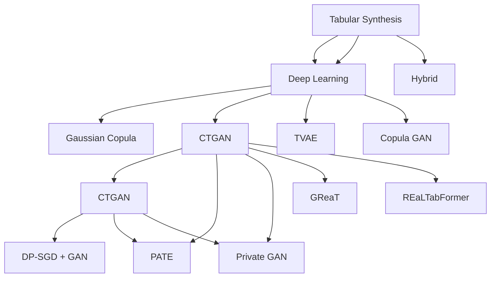

# Tabular Synthetic Data Generation

A comprehensive guide to generating synthetic tabular data using SDV, Synthcity, ydata-synthetic, and other tools.

---

## 1. Overview of Tabular Synthesis Approaches



---

## 1. SDV (Synthetic Data Vault) - The Standard

### 1.1 Installation & Setup
```bash
pip install sdv
# Or with all extras
pip install sdv[all]
```

### 1.1 Core Components
```python
from sdv.metadata import SingleTableMetadata, MultiTableMetadata
from sdv.single_table import (
    GaussianCopulaSynthesizer,  # Statistical, fast
    CTGANSynthesizer,           # GAN-based, complex distributions
    TVAESynthesizer,            # VAE-based
    CopulaGANSynthesizer        # Copula + GAN
)
from sdv.metadata import SingleTableMetadata, MultiTableMetadata
from sdv.evaluation.single_table import evaluate_quality, run_diagnostic
from sdv.evaluation.multi_table import evaluate_quality as eval_multi
```

---

## 2. Single Table Synthesis (SDV)

### 1. Metadata Creation
```python
from sdv.metadata import SingleTableMetadata
import pandas as pd

# Load data
df = pd.read_csv('data.csv')

# Auto-detect metadata
metadata = SingleTableMetadata()
metadata.detect_from_dataframe(df)

# OR manual specification
metadata = SingleTableMetadata()
metadata.add_column('user_id', sdtype='id')
metadata.add_column('age', sdtype='numerical', 
                    computer_representation='Int64')
metadata.add_column('income', sdtype='numerical', 
                    computer_representation='Float64')
metadata.add_column('category', sdtype='categorical')
metadata.add_column('email', sdtype='email')
metadata.add_column('ssn', sdtype='ssn', pii=True)
metadata.add_column('date', sdtype='datetime', 
                    datetime_format='%Y-%m-%d')

# Constraints
from sdv.constraints import Unique, GreaterThan, ScalarRange
metadata.add_constraint(Unique(column='user_id'))
metadata.add_constraint(ScalarRange(column='age', low=0, high=120))
metadata.add_constraint(GreaterThan(column='end_date', reference='start_date'))

# Save/load metadata
metadata.save_to_json('metadata.json')
metadata = SingleTableMetadata.load_from_json('metadata.json')
```

### 2. Model Selection Guide

| Model | Best For | Speed | Quality | Data Types |
|-------|----------|-------|----------|------------|
| **GaussianCopula** | Fast, statistical | Fast | Good | Mixed |
| **CTGAN** | Complex distributions | Slow | High | Mixed (categorical heavy) |
| **TVAE** | VAE-based | Medium | High | Mixed |
| **CopulaGAN** | Correlations + GAN | Medium | High | Mixed |

### 3. Model Selection Guide
```python
def select_synthesizer(data, metadata):
    """
    Heuristic for model selection:
    - < 10k rows, simple distributions → GaussianCopula (fast)
    - > 10k rows, complex distributions → CTGAN
    - Need uncertainty estimates → TVAE
    - Strong correlations → CopulaGAN
    - Need differential privacy → DP-CTGAN (with DP)
    """
    n_rows = len(data)
    n_categorical = len(data.select_dtypes(include='object').columns)
    n_numeric = len(data.select_dtypes(include='number').columns)
    
    if len(data) < 5000:
        return 'GaussianCopula'
    elif n_categorical > 10:
        return 'CTGAN'
    else:
        return 'TVAE'
```

---

## 2. Single Table Synthesis (SDV)

### 2.1 Basic Workflow
```python
from sdv.single_table import GaussianCopulaSynthesizer, CTGANSynthesizer, TVAESynthesizer
from sdv.metadata import SingleTableMetadata
from sdv.evaluation.single_table import evaluate_quality, run_diagnostic

# 1. Load data
df = pd.read_csv('data.csv')

# 2. Create metadata
metadata = SingleTableMetadata()
metadata.detect_from_dataframe(df)

# 3. Choose synthesizer
# Option A: GaussianCopula (fast, statistical)
synthesizer = GaussianCopulaSynthesizer(metadata)

# Option B: CTGAN (complex distributions)
synthesizer = CTGANSynthesizer(metadata, epochs=300, batch_size=500)

# Option C: TVAE (VAE-based)
synthesizer = TVAESynthesizer(metadata, epochs=300)

# 5. Fit
synthesizer.fit(df)

# 5. Generate
synthetic = synthesizer.sample(num_rows=10000)

# 6. Evaluate
quality_report = evaluate_quality(real_data=df, synthetic_data=synthetic, metadata=metadata)
print(f"Quality Score: {quality_report.get_score():.3f}")

# Visualize
quality_report.get_visualization('Column Shapes')
quality_report.get_visualization('Column Pair Trends')
```

### 2.1 Advanced CTGAN Configuration
```python
from sdv.single_table import CTGANSynthesizer

synthesizer = CTGANSynthesizer(
    metadata,
    epochs=300,
    batch_size=500,
    generator_lr=2e-4,
    discriminator_lr=2e-4,
    generator_dim=(256, 256),
    discriminator_dim=(256, 256),
    pac=10,  # PacGAN discriminator
    cuda=True,
    verbose=True
)
```

### 2.1 Constraints & Business Logic
```python
from sdv.constraints import (
    Unique, GreaterThan, LessThan, 
    ScalarRange, GreaterThan, LessThan,
    Inequality, ScalarInequality
)

# Unique constraint
metadata.add_constraint(Unique(column='user_id'))

# Range constraints
metadata.add_constraint(ScalarRange(column='age', low=0, high=120))
metadata.add_constraint(ScalarRange(column='salary', low=0))

# Conditional
metadata.add_constraint(GreaterThan(column='end_date', reference='start_date'))
metadata.add_constraint(Inequality(low='start_salary', high='end_salary'))

# Custom constraint
from sdv.constraints import CustomConstraint

class BusinessRule(CustomConstraint):
    def _get_columns(self):
        return ['status', 'amount']
    
    def _is_valid(self, data, **kwargs):
        # Business logic: refunds only for completed orders
        return (data['status'] != 'refunded') | (data['amount'] < 0)

metadata.add_constraint(BusinessRule())
```

---

## 2. Multi-Table / Relational Data (SDV)

### 2.1 Relational Metadata
```python
from sdv.metadata import MultiTableMetadata

metadata = MultiTableMetadata()

# Add tables
metadata.detect_from_dataframes({
    'users': users_df,
    'orders': orders_df,
    'items': order_items_df
})

# Define relationships
metadata.add_relationship(
    parent_table_name='users',
    child_table_name='orders',
    parent_key='user_id',
    child_key='user_id'
)

metadata.add_relationship(
    parent_table_name='orders',
    child_table_name='order_items',
    parent_key='order_id',
    child_key='order_id'
)

# Primary keys
metadata.tables['users'].set_primary_key('user_id')
metadata.tables['orders'].add_primary_key('order_id')
metadata.tables['items'].add_primary_key('item_id')
```

### 2. Relational Synthesis (HMA1)
```python
from sdv.relational import HMA1Synthesizer

synthesizer = HMA1Synthesizer(metadata)
synthesizer.fit({
    'users': users_df,
    'orders': orders_df,
    'items': items_df
})

# Generate synthetic data for all tables
synthetic = synthesizer.sample(scale=2.0)  # 2x data

# Access individual tables
synthetic_users = synthetic['users']
synthetic_orders = synthetic['orders']
```

---

## 3. ydata-synthetic

### Installation
```bash
pip install ydata-synthetic
```

### Basic Usage
```python
from ydata_synthetic.synthesizers import TrainParameters
from ydata_synthetic.synthesizers.regular import RegularSynthesizer

# CTGAN
train_params = TrainParameters(
    epochs=300,
    batch_size=500,
    lr=2e-4,
    beta_1=0.5,
    beta_2=0.9
)

synth = RegularSynthesizer(
    modelname='ctgan',  # 'ctgan', 'wgan', 'wgan-gp', 'cgan', 'vanilla'
    parameters=TrainParameters(epochs=300, batch_size=500)
)

synth.fit(df, num_cols=num_cols, cat_cols=cat_cols)
synthetic = synth.sample(10000)
```

---

## 3. Synthcity

### Installation
```bash
pip install synthcity
```

### Benchmarking Multiple Models
```python
from synthcity.plugins import Plugins
from synthcity.plugins.core.dataloader import GenericDataLoader

# List available models
Plugins().list()

# Benchmark multiple models
from synthcity.benchmark import Benchmark

benchmark = Benchmark()
results = benchmark.run(
    models=['ctgan', 'tvae', 'gaussian_copula', 'ctabgan', 'dpgan'],
    datasets=[train_data],
    metrics=['fidelity', 'privacy', 'utility'],
    n_iter=3
)

# Results
results.table()
results.plot()
```

---

## 3. Evaluation & Quality Assessment

### 1. SDV Evaluation
```python
from sdv.evaluation.single_table import evaluate_quality, run_diagnostic
from sdv.evaluation.multi_table import evaluate_quality as eval_multi

# Single table
quality_report = evaluate_quality(
    real_data=real_df,
    synthetic_data=synthetic_df,
    metadata=metadata
)

print(f"Overall Score: {quality_report.get_score():.3f}")

# Detailed report
print(quality_report.get_details())
print(quality_report.get_properties())

# Visualizations
quality_report.get_visualization('Column Shapes')
quality_report.get_visualization('Column Pair Trends')

# Diagnostic
diag = run_diagnostic(real_data, synthetic_data, metadata)
print(diag)
```

### 2. Synthcity Evaluation
```python
from synthcity.metrics import (
    eval_fidelity, eval_utility, eval_privacy
)
from synthcity.metrics import (
    alpha_precision, beta_recall, authenticity
)

# Fidelity (statistical distance)
fidelity = eval_fidelity(real_data, synthetic_data)

# Utility (downstream task)
utility = eval_utility(
    real_train, synth_train, real_test,
    task='classification', model=XGBClassifier()
)

# Privacy
privacy = eval_privacy(real_data, synthetic_data)
```

---

## 5. Evaluation Metrics Reference

### 1. Fidelity Metrics
| Metric | Description | Function |
|--------|--------------|----------|
| **KS Test** | KS statistic | `ks_2samp(real, synth)` |
| **KS p-value** | p-value > 0.05 = similar | `ks_2samp(real, synth).pvalue` |
| **KS Distance** | Max CDF difference | `ks_2samp(real, synth).statistic` |
| **Wasserstein Distance** | Earth Mover's Distance | `wasserstein_distance(real, synth)` |
| **JS Divergence** | Jensen-Shannon | `jensenshannon(p, q)` |
| **KS Test** | Kolmogorov-Smirnov | `ks_2samp(real, synth)` |
| **MMD** | Maximum Mean Discrepancy | `mmd_rbf(X, Y)` |
| **Correlation Diff** | `|corr_real - corr_synth|` | `np.abs(corr_real - corr_syn).max()` |

### 2. Utility Metrics (TSTR/TRTS)
```python
# Train on Synthetic, Test on Real (TSTR)
def tstr_score(synth_data, real_train, real_test, model_class, **kwargs):
    model = model_class().fit(synth_train.X, synth_train.y)
    return model.score(real_test.X, real_test.y)

# Train on Real, Test on Synthetic (TRTS)
def trts_score(model, synth_test, real_test):
    model.fit(real_train)
    return model.score(synth_test.X, synth_test.y)

# Target: TSTR ≈ Real performance, TRTS ≈ Real performance
```

### 3. Privacy Metrics
```python
# Membership Inference Attack
def membership_inference_attack(model, train_data, test_data, synthetic):
    # Train attack model
    train_combined = np.vstack([train_data, synthetic])
    labels = np.hstack([np.ones(len(train)), np.zeros(len(synthetic))])
    
    attack_model = RandomForestClassifier()
    attack.fit(np.vstack([train, synthetic]), labels)
    
    # Evaluate on test
    preds = attack_model.predict_proba(test_data)[:, 1]
    auc = roc_auc_score(true_labels, preds)
    return auc  # Should be ~0.5 for good privacy

# Attribute Inference
def attribute_inference_attack(model, X, target_col):
    # Can we predict sensitive attr from other features?
    pass
```

---

## 5. Evaluation Metrics Cheatsheet

| Aspect | Metric | Function | Good Threshold |
|-------|--------|----------|----------------|
| **Fidelity** | KS Test p-value | `ks_2samp` p-value | > 0.05 |
| | KS Distance | `ks_2samp(...).statistic` | < 0.1 |
| | JS Divergence | `jensenshannon(p, q)` | < 0.1 |
| | Wasserstein | `wasserstein_distance()` | < 0.1 |
| | Correlation Diff | `np.abs(corr_r - corr_s).max()` | < 0.1 |
| | MMD | `mmd_rbf()` | < 0.1 |
| **Utility (TSTR)** | Train Synth → Test Real | Match real performance | ±5% |
| **Privacy** | Membership Inference AUC | < 0.55 |
| | Attribute Inference | AUC | < 0.6 |
| | k-Anonymity | k ≥ 5 |
| | l-Diversity | l ≥ 3 |

---

## 4. Advanced Topics

### 1. Conditional Generation
```python
# Conditional generation (specific conditions)
synthesizer = CTGANSynthesizer(metadata)
synthesizer.fit(df)

# Generate with condition
condition = {'category': 'electronics', 'price': (100, 500)}
synthetic = synthesizer.sample_remaining_columns(
    known_columns={'category': 'electronics', 'price_range': '100-500'},
    num_rows=1000
)

# Conditional sampling with SDV
condition = {'category': 'electronics', 'price': {'min': 100, 'max': 500}}
synthetic = synthesizer.sample_from_conditions(
    conditions=[{'category': 'electronics', 'price': {'min': 100, 'max': 500}}],
    num_rows=1000
)
```

### 2. Conditional Sampling with Synthcity
```python
from synthcity.plugins import Plugins

# Conditional generation
model = Plugins().get('ctgan')
model.fit(X_train, y_train)

# Conditional generation
X_cond = X_test[['condition_col']]
y_syn = model.generate(X_cond)
```

### 3. Sequential/Conditional Generation
```python
# Sequential generation for time series
from sdv.sequential import PARSynthesizer

synthesizer = PARSynthesizer(
    metadata,
    sequence_index='timestamp',
    context_columns=['user_id'],
    sequence_length=24
)
```

---

## 5. Best Practices Checklist

```markdown
## Pre-Generation Checklist
- [ ] Data profiling complete (distributions, correlations, missingness)
- [ ] Quality thresholds defined (fidelity, utility, privacy)
- [ ] Privacy requirements defined (DP, k-anon, etc.)
- [ ] Evaluation metrics defined (fidelity, utility, privacy)
- [ ] Baseline models trained on real data (benchmark)

### Generation
- [ ] Model appropriate for data type/complexity
- [ ] Constraints defined (FK, ranges, business rules)
- [ ] Class imbalance handled (stratified sampling, focal loss)
- [ ] Temporal dependencies handled (if time series)
- [ ] Categorical encoding handled (rare categories)

### Validation
- [ ] Statistical fidelity (KS, JS, Wasserstein, correlation)
- [ ] Utility: TSTR / TRTS within 5% of real performance
- [ ] Privacy: Membership inference AUC < 0.55
- [ ] Attribute inference AUC < 0.6
- [ ] k-anonymity ≥ 5, l-diversity ≥ 3
- [ ] Domain expert review (sample inspection)

### Deployment
- [ ] Model versioned & tracked (MLflow/MLflow)
- [ ] Monitoring: data drift, concept drift, quality drift
- [ ] Automated retraining pipeline
- [ ] Rollback capability
- [ ] Documentation (model card)
```

---

## Quick Reference: Model Selection

| Data Type | Size | Complexity | Recommended |
|-----------|------|------------|-------------|
| Tabular, <10K, simple | Fast | GaussianCopula |
| Tabular, >10K, complex | High quality | CTGAN / TVAE |
| Mixed types, referential | Relational | SDV Relational / Synthcity |
| Time Series | Temporal | NeuralForecast, StatsForecast |
| Text | LLM-based | Gretel, LangChain + LLM |
| Privacy (DP) | DP required | DP-SGD, Private GAN, PATE |
| Images | Diffusion | Stable Diffusion, ControlNet |
| Text | LLM-based | LLM fine-tune, Gretel |

---

*Last updated: 2024-11-05*
*Part of: Synthetic Data Knowledge Base*