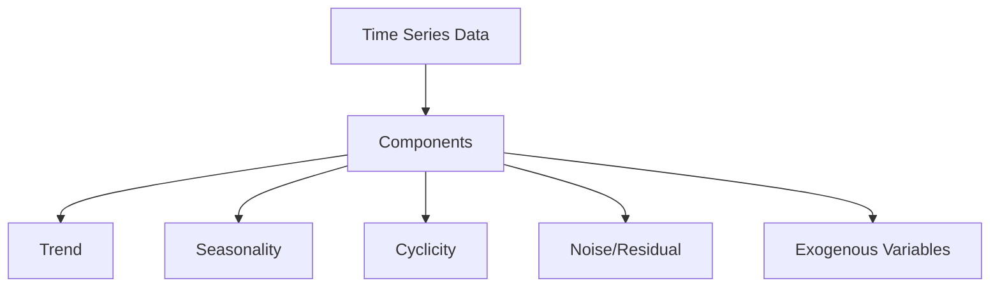

# Time Series Synthetic Data Generation

A comprehensive reference for generating synthetic time series data using various methods and libraries.

---

## 1. Time Series Synthetic Data Overview

### 1.1 Time Series Data Characteristics


### 1.1 Time Series Components
```python
# Decomposition
from statsmodels.tsa.seasonal import seasonal_decompose

decomposition = seasonal_decompose(ts, model='additive', period=12)
# or multiplicative
decomposition = seasonal_decompose(ts, model='multiplicative', period=12)

trend = decomp.trend
seasonal = decomp.seasonal
residual = decomp.resid

# Access components
trend.plot()
seasonal.plot()
residual.plot()
```

---

## 2. Synthetic Time Series Generation Methods

### 1. Statistical / Parametric Methods
```python
import numpy as np
import pandas as pd

# Basic synthetic TS components
def generate_ts(n=1000, trend='linear', seasonality='yearly', noise=0.1):
    t = np.arange(n)
    
    # Trend
    if trend == 'linear':
        trend = 0.01 * t
    elif trend == 'quadratic':
        trend = 0.0001 * t**2
    elif trend == 'exponential':
        trend = 0.01 * np.exp(0.01 * t)
    else:
        trend = 0
    
    # Seasonality
    if seasonality == 'yearly':
        seasonal = 10 * np.sin(2 * np.pi * t / 365.25)
    elif seasonality == 'weekly':
        seasonal = 5 * np.sin(2 * np.pi * t / 7)
    elif seasonality == 'daily':
        seasonal = 3 * np.sin(2 * np.pi * t / 24)
    else:
        seasonal = 0
    
    # Cyclic (longer than seasonal)
    cyclic = 3 * np.sin(2 * np.pi * t / 365.25 * 4)  # 4-year cycle
    
    # Noise
    noise = np.random.normal(0, noise, n)
    
    return trend + seasonal + cyclic + noise
```

### 2. ARIMA Simulation
```python
from statsmodels.tsa.arima_process import ArmaProcess
from statsmodels.tsa.arima.model import ARIMA

# ARMA Process
ar = np.array([1, -0.75, 0.25])  # AR coefficients
ma = np.array([1, 0.5])           # MA coefficients
arma_process = ArmaProcess(ar, ma)
ts = arma_process.generate_sample(nsample=1000)

# ARIMA simulation
model = ARIMA(data, order=(1, 1, 1))
fit = model.fit()
forecast = fit.forecast(steps=30)

# Simulate from fitted model
simulated = fit.simulate(nsimulations=100)
```

### 2. State Space Models
```python
from statsmodels.tsa.statespace.sarimax import SARIMAX

# SARIMAX simulation
model = SARIMAX(data, order=(1,1,1), seasonal_order=(1,1,1,12))
fit = model.fit()
simulated = fit.simulate(nsimulations=100)
```

---

## 2. Deep Learning Time Series Generation

### 1. NeuralForecast (Nixtla)
```python
# pip install neuralforecast
from neuralforecast import NeuralForecast
from neuralforecast.models import NBEATS, NHITS, TFT, TimesNet, TiDE
from neuralforecast.losses.pytorch import MAE, MSE

# Models
models = [
    NBEATS(input_size=24, h=12, loss=MAE()),
    NHITS(input_size=24, h=12, loss=MAE()),
    TFT(input_size=24, h=12, loss=MAE()),
    TimesNet(input_size=24, h=12),
    TiDE(input_size=24, h=12)
]

nf = NeuralForecast(models=models, freq='H')
nf.fit(df)
forecasts = nf.predict(futr_df)
```

### 2. NeuralProphet
```python
# pip install neuralprophet
from neuralprophet import NeuralProphet

m = NeuralProphet(
    n_forecasts=12,
    n_lags=24,
    yearly_seasonality=True,
    weekly_seasonality=True,
    daily_seasonality=True,
    n_changepoints=10
)

m.fit(df, freq='D')
future = m.make_future_dataframe(df, periods=30)
forecast = m.predict(future)
```

### 3. StatsForecast (Fast Statistical)
```python
# pip install statsforecast
from statsforecast import StatsForecast
from statsforecast.models import AutoARIMA, ETS, MSTL, SeasonalNaive

sf = StatsForecast(
    models=[AutoARIMA(), ETS(), MSTL(season_length=12)],
    freq='M',
    n_jobs=-1
)

sf.fit(df)
forecasts = sf.forecast(h=12, level=[80, 95])
```

### 4. GluonTS (Amazon)
```python
# pip install gluonts
from gluonts.model.deepar import DeepAREstimator
from gluonts.trainer import Trainer
from gluonts.dataset.common import ListDataset

estimator = DeepAREstimator(
    freq='D',
    prediction_length=30,
    trainer=Trainer(epochs=100, device='cuda')
)

train_data = ListDataset([
    {"start": df.index[0], "target": df['value'].values}
], freq='D')

predictor = estimator.train(training_data=train_data)
forecasts = list(predictor.predict(test_data))
```

---

## 2. Specialized Time Series Synthesis

### 1. Synthetic Time Series with Trend + Seasonality
```python
def generate_ts(n=1000, trend='linear', seasonality='yearly', noise=0.1):
    t = np.arange(n)
    
    # Trend
    if trend == 'linear':
        trend = 0.01 * t
    elif trend == 'quadratic':
        trend = 0.0001 * t**2
    elif trend == 'exp':
        trend = 0.01 * np.exp(0.01 * t)
    else:
        trend = 0
    
    # Seasonality
    if seasonality == 'yearly':
        seasonal = 10 * np.sin(2 * np.pi * t / 365.25)
    elif seasonality == 'weekly':
        seasonal = 5 * np.sin(2 * np.pi * t / 7)
    elif seasonality == 'daily':
        seasonal = 3 * np.sin(2 * np.pi * t / 24)
    else:
        seasonal = 0
    
    # Cyclic
    cyclic = 3 * np.sin(2 * np.pi * t / (365.25 * 4))  # 4-year cycle
    
    # Noise
    noise = np.random.normal(0, noise, n)
    
    return trend + seasonal + noise
```

### 2. Regime Switching / HMM
```python
# Hidden Markov Model for regime switching
from hmmlearn import hmm

# Generate HMM-based time series
model = hmm.GaussianHMM(n_components=3, covariance_type="full")
model.startprob_ = np.array([0.6, 0.3, 0.1])
model.transmat_ = np.array([[0.7, 0.2, 0.1],
                            [0.1, 0.8, 0.1],
                            [0.1, 0.2, 0.7]])
model.means_ = np.array([[0], [5], [-5]])
model.covars_ = np.tile(np.eye(1), (3, 1, 1))

X, Z = model.sample(1000)

# Fit to data
model.fit(data)
generated = model.sample(1000)
```

### 3. State Space Models
```python
from statsmodels.tsa.statespace import SARIMAX
from statsmodels.tsa.statespace.sarimax import SARIMAX

# SARIMAX simulation
model = SARIMAX(data, order=(1,1,1), seasonal_order=(1,1,1,12))
fit = model.fit()
simulated = fit.simulate(nsimulations=100)
```

---

## 4. Deep Learning for Time Series

### 1. TimeGAN (Synthcity)
```python
# pip install synthcity
from synthcity.plugins import Plugins
from synthcity.plugins.core.dataloader import GenericDataLoader

# TimeGAN
Plugins().list()  # shows 'timegan' available

from synthcity.plugins.generic import TimeGAN
model = TimeGAN(
    seq_len=24,
    n_features=10,
    hidden_dim=64,
    num_layers=3
)

# Prepare data (B, T, D)
X = df.values.reshape(-1, seq_len, n_features)
model = TimeGAN(seq_len=24, n_features=n_features)
model.fit(X)
synthetic = model.generate(n_samples=1000)
```

### 2. Diffusion for Time Series
```python
# Diffusion models for TS
# pip install diffusers
from diffusers import DDPMPipeline

# Or use tsdiff
# pip install tsdiff
from tsdiff import DiffusionTS

model = DiffusionTS(
    seq_len=96,
    n_features=7,
    hidden_dim=128,
    num_layers=4
)
model.fit(train_data)
synthetic = model.generate(n_samples=1000)
```

---

## 2. Advanced Synthetic TS Methods

### 1. Copula-Based Time Series
```python
from copulas.multivariate import GaussianMultivariate
from copulas.univariate import GaussianUnivariate

# Fit copula
copula = GaussianMultivariate()
copula.fit(df)

# Sample
synthetic = copula.sample(10000)

# With temporal dependence
from copulas.tsa import TimeSeriesCopula
ts_copula = TimeSeriesCopula()
ts_copula.fit(df)
synthetic = ts_copula.sample(1000)
```

### 2. Copula-Based Time Series
```python
from copulas.tsa import TimeSeriesCopula

ts_copula = TimeSeriesCopula(
    univariate=GaussianUnivariate,
    max_lag=24
)
ts_copula.fit(df)
synthetic = ts_copula.sample(1000)
```

---

## 3. Advanced Synthetic TS Methods

### 1. Diffusion Models for Time Series
```python
# Diffusion models for TS
# pip install tsdiff
from tsdiff import DiffusionTS

model = DiffusionTS(
    seq_len=96,
    n_features=7,
    hidden_dim=128,
    num_layers=4
)
model.fit(train_data)
synthetic = model.generate(n_samples=1000)
```

### 2. Flow Matching for Time Series
```python
# Flow Matching for TS
# pip install torchcfm
from torchcfm import FlowMatching

# OT-CFM (Optimal Transport Conditional Flow Matching)
from torchcfm import ConditionalFlowMatching

fm = ConditionalFlowMatching(sigma=0.1)
v = fm.forward(t, x0, x1)
loss = (v - v_pred)**2
```

---

## 3. Evaluation Metrics for Time Series

### 1. Fidelity Metrics
```python
from scipy.stats import ks_2samp, wasserstein_distance
from scipy.spatial.distance import jensenshannon
from scipy.spatial.distance import jensenshannon
from scipy.stats import ks_2samp
from scipy.spatial.distance import jensenshannon
from scipy.spatial.distance import wasserstein_distance

# Distribution similarity
ks_stat, p_val = ks_2samp(real, synthetic)
ws_dist = wasserstein_distance(real, synthetic)
jsd = jensenshannon(real_hist, synth_hist)

# ACF/PACF similarity
from statsmodels.tsa.stattools import acf, pacf
acf_real = acf(real, nlags=20)
acf_syn = acf(syn, nlags=20)
acf_diff = np.abs(acf_real - acf_syn).max()

# Spectral similarity
from scipy.signal import periodogram
f_real, psd_real = periodogram(real)
f_syn, psd_syn = periodogram(syn)
spectral_diff = np.mean((psd_real - psd_syn)**2)
```

### 2. Forecasting Utility
```python
# Train on synthetic, test on real (TSTR)
def tstr_evaluation(synth_data, real_train, real_test, model):
    model.fit(synth_train)
    pred = model.predict(real_test)
    return metric(real_test, pred)

# Train on real, test on synthetic (TRTS)
def trts_evaluation(model, synth_test, real_test):
    model.fit(real_train)
    pred = model.predict(synth_test)
    return metric(real_test, pred)

# Forecasting accuracy
from sklearn.metrics import mean_absolute_error, mean_squared_error

def forecast_accuracy(forecast, actual):
    return {
        'MAE': mean_absolute_error(actual, forecast),
        'RMSE': np.sqrt(mean_squared_error(actual, forecast)),
        'MAPE': np.mean(np.abs((actual - forecast) / actual)) * 100
    }
```

---

## 3. Specialized Time Series Types

### 1. Multivariate Time Series
```python
# Vector Autoregression (VAR)
from statsmodels.tsa.api import VAR

model = VAR(df)
fit = model.fit(maxlags=12, ic='aic')
forecast = fit.forecast(df.values[-12:], steps=12)

# Structural VAR
from statsmodels.tsa.api import SVAR
svar = SVAR(var_result, A=..., B=...)
```

### 2. Hierarchical / Grouped Time Series
```python
# Hierarchical forecasting
from hierarchicalforecast import HierarchicalForecast
from hierarchicalforecast.methods import BottomUp, TopDown, MiddleOut

hierarchical = HierarchicalForecast(
    models=[model1, model2],
    method='BottomUp'
)
```

---

## 5. Evaluation Metrics for Time Series

### 1. Forecasting Metrics
```python
from sklearn.metrics import mean_absolute_error, mean_squared_error, mean_absolute_percentage_error
from sklearn.metrics import mean_absolute_percentage_error

def forecast_metrics(y_true, y_pred):
    return {
        'MAE': mean_absolute_error(y_true, y_pred),
        'RMSE': np.sqrt(mean_squared_error(y_true, y_pred)),
        'MAPE': np.mean(np.abs((y_true - y_pred) / y_true)) * 100,
        'SMAPE': 100 * np.mean(2 * np.abs(y_pred - y_true) / (np.abs(y_true) + np.abs(y_pred))),
        'MASE': mean_absolute_error(y_true, y_pred) / 
                mean_absolute_error(y_true[:-1], y_true[1:]),  # MASE
        'RMSSE': np.sqrt(mean_squared_error(y_true, y_pred)) / 
                 np.sqrt(np.mean((y_true[1:] - y_true[:-1])**2))
    }
```

### 2. Probabilistic Forecasting Metrics
```python
# Quantile loss
def quantile_loss(y_true, y_pred, quantile):
    return np.mean(np.maximum(quantile * (y_true - y_pred), (quantile - 1) * (y_true - y_pred)))

# CRPS (Continuous Ranked Probability Score)
from prophet.diagnostics import cross_validation
from prophet.diagnostics import performance_metrics

# CRPS
from prophet.diagnostics import cross_validation
cv = cross_validation(m, initial='730 days', period='180 days', horizon='90 days')
perf = performance_metrics(cv)
```

### 3. Interval Coverage
```python
# Prediction interval coverage
def coverage(y_true, lower, upper):
    return np.mean((y_true >= lower) & (y_true <= upper))

# Interval width
def interval_width(lower, upper):
    return np.mean(upper - lower)

# Winkler score
def winkler_score(y_true, lower, upper, alpha=0.1):
    width = upper - lower
    penalty = 2/alpha * (lower - y_true) * (y_true < lower) + 2/alpha * (y_true - upper) * (y_true > upper)
    return np.mean(width + penalty)
```

---

## 5. Advanced Topics

### 1. Causal Synthetic Time Series
```python
# Causal discovery
from cdt.causality.graph import PC, GES, GES
from causalnex.structure import StructureModel

# Causal discovery from time series
from cdt.causality.graph import PC
pc = PC()
graph = pc.predict(ts_data)

# Structural causal model for time series
from causalnex.structure import StructureModel
sm = StructureModel()
sm.fit(df)
```

### 2. Counterfactual Time Series
```python
# Counterfactual forecasting
# What would have happened without intervention?

from causalimpact import CausalImpact

impact = CausalImpact(
    data=pre_post_data,
    pre_period=['2023-01-01', '2024-01-01'],
    post_period=['2024-01-02', '2024-12-31']
)
impact.plot()
print(impact.summary())
```

---

## 8. Evaluation Checklist for Time Series

```markdown
## Time Series Synthetic Data Checklist

### Pre-Generation
- [ ] Stationarity assessed (ADF, KPSS)
- [ ] Seasonality identified (period, strength)
- [ ] Trend characterized (linear, exponential, nonlinear)
- [ ] Autocorrelation structure analyzed (ACF/PACF)
- [ ] Outliers/anomalies identified and handled

### Generation
- [ ] Model captures trend, seasonality, cycles
- [ ] Residuals resemble white noise
- [ ] Cross-correlations preserved (multivariate)
- [ ] Regime changes / structural breaks handled

### Validation
- [ ] ACF/PACF match
- [ ] Spectral density match
- [ ] Distributional similarity (KS, KS-test)
- [ ] Forecasting utility (TSTR/TRTS)
- [ ] Extreme value preservation
- [ ] Tail behavior preserved
- [ ] Cross-correlations (multivariate)

### Production
- [ ] Forecasting utility (TSTR/TRTS)
- [ ] Prediction interval coverage
- [ ] Drift monitoring
- [ ] Automated retraining trigger
```

---

*Last updated: 2024-11-05*
*Part of: Synthetic Data Knowledge Base*