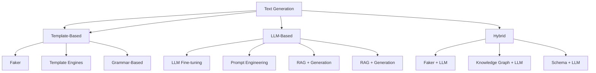

# Text & NLP Synthetic Data Generation

A comprehensive guide to generating synthetic text, NLP, and language data.

---

## 1. Text Generation Approaches



---

## 1. Basic Text Generation with Faker

### 1.1 Basic Text Generation
```python
from faker import Faker

fake = Faker()
fake = Faker('en_US')  # or 'en_GB', 'de_DE', 'ja_JP', 'zh_CN', etc.

# Basic text
fake.sentence()                    # 'Lorem ipsum dolor sit amet.'
fake.sentence(nb_words=10)        # 10-word sentence
fake.paragraph(nb_sentences=3)    # 3-sentence paragraph
fake.paragraphs(nb=3)             # List of 3 paragraphs
fake.text(max_nb_chars=200)       # Up to 200 chars
fake.texts(nb_texts=5)            # List of 5 texts

# Structured text
fake.email()                      # 'user@example.com'
fake.url()                        # 'https://example.com'
fake.url(schemes=['http', 'https'])
fake.domain_name()                # 'example.com'
fake.domain_word()                # 'example'
fake.tld()                        # 'com', 'org', 'net'
fake.ipv4()                       # '192.168.1.1'
fake.ipv6()                       # '2001:db8::1'
fake.mac_address()                # '00:1a:2b:3c:4d:5e'
fake.user_agent()                 # 'Mozilla/5.0...'
fake.chrome()                     # Chrome UA string
fake.safari()
fake.firefox()
fake.linux_platform_token()
fake.mac_processor()
```

### 1.2 Structured Text Data
```python
from faker import Faker
import json

fake = Faker()

# JSON
fake.json()                           # Random JSON
fake.json(data_columns={'name': 'name', 'email': 'email'})

# XML
fake.xml()

# CSV
fake.csv(header=['name', 'email'], rows=10)

# Structured records
def generate_records(n=100):
    records = []
    for _ in range(n):
        records.append({
            'id': fake.uuid4(),
            'name': fake.name(),
            'email': fake.email(),
            'address': {
                'street': fake.street_address(),
                'city': fake.city(),
                'state': fake.state_abbr(),
                'zip': fake.zipcode()
            },
            'phone': fake.phone_number(),
            'company': fake.company(),
            'job': fake.job(),
            'salary': round(np.random.lognormal(10, 0.5), 2),
            'active': fake.boolean()
        }
    return records

records = generate_records(1000)
```

---

## 2. LLM-Based Synthetic Text Generation

### 1. LangChain + LLM for Structured Data
```python
from langchain.chains import LLMChain
from langchain.prompts import PromptTemplate
from langchain.llms import OpenAI
from langchain.output_parsers import PydanticOutputParser
from pydantic import BaseModel, Field

# Define output schema
class CustomerRecord(BaseModel):
    customer_id: str = Field(description="Unique customer ID")
    name: str = Field(description="Full name")
    email: str = Field(description="Email address")
    age: int = Field(ge=18, le=100)
    city: str
    purchase_amount: float = Field(ge=0)
    category: str = Field(description="Product category")

parser = PydanticOutputParser(pydantic_object=CustomerRecord)

prompt = PromptTemplate(
    template="Generate a synthetic customer record.\n{format_instructions}\n\nCustomer:",
    partial_variables={"format_instructions": parser.get_format_instructions()}
)

llm = OpenAI(temperature=0.7)
chain = LLMChain(llm=llm, prompt=prompt, output_parser=parser)

# Generate batch
records = []
for _ in range(100):
    result = chain.run({})
    records.append(parser.parse(result))
```

### 2. Structured Output with Instructor
```python
# pip install instructor
import instructor
from openai import OpenAI

client = instructor.patch(OpenAI())

class CustomerRecord(BaseModel):
    customer_id: str
    name: str
    email: str
    age: int
    city: str
    purchase_amount: float
    category: str

# Generate with validation
records = []
for _ in range(100):
    record = client.chat.completions.create(
        model="gpt-4",
        response_model=CustomerRecord,
        messages=[{
            "role": "user",
            "content": "Generate a realistic customer record for an e-commerce platform."
        }
    ])
    records.append(record.model_dump())
```

### 3. Structured Output with JSON Schema
```python
from langchain.output_parsers import JsonOutputParser

parser = JsonOutputParser(pydantic_object=CustomerRecord)

prompt = PromptTemplate(
    template="Generate {n} customer records matching this schema:\n{schema}",
    partial_variables={"schema": CustomerRecord.schema_json()}
)

chain = prompt | llm | JsonOutputParser()

results = chain.batch([{"n": 10} for _ in range(10)])
```

---

## 3. Specialized Text Generation

### 1. Structured Text (JSON, XML, CSV)
```python
from faker import Faker
import json

fake = Faker()

# JSON
fake.json(
    data_columns={'name': 'name', 'email': 'email', 'age': 'pyint'},
    num_rows=10
)

# XML
fake.xml()

# CSV
fake.csv(header=['name', 'email', 'age'], rows=100)

# Custom structured
fake.json(
    data_columns={
        'id': 'uuid4',
        'name': 'name',
        'email': 'email',
        'address': 'address',
        'phone': 'phone_number'
    },
    num_rows=100
)
```

### 2. Code Generation
```python
from langchain.chains import LLMChain
from langchain.prompts import PromptTemplate

code_prompt = PromptTemplate(
    input_variables=["language", "task"],
    template="""
Write a {language} function that {task}.
Include type hints, docstring, and error handling.
"""
```

### 3. Code Generation with LLMs
```python
from langchain.chains import LLMChain

code_prompt = PromptTemplate(
    input_variables=["language", "task"],
    template="""
Write a {language} function that {task}.
Include type hints, docstring, and error handling.
"""
)

chain = LLMChain(llm=llm, prompt=code_prompt)
code = chain.run(language="Python", task="reads a CSV and returns summary statistics")
```

---

## 4. Specialized Text Generation

### 1. Domain-Specific Text
```python
# Legal documents
legal_prompt = PromptTemplate(
    template="Generate a {doc_type} legal document for {jurisdiction}. Include standard clauses.",
    input_variables=["doc_type", "jurisdiction"]
)

# Medical notes
medical_prompt = PromptTemplate(
    template="Generate a clinical note for a patient with {condition}. "
             "Include: chief complaint, HPI, assessment, plan.",
    input_variables=["condition"]
)

# Financial reports
fin_prompt = PromptTemplate(
    template="Generate a {report_type} financial report for {company} "
             "for {period}. Include revenue, expenses, net income.",
    input_variables=["report_type", "company", "period"]
)
```

### 2. Code Generation
```python
from langchain.chains import LLMChain

code_prompt = PromptTemplate(
    input_variables=["language", "task"],
    template="""
Write a {language} function that {task}.
Include:
- Type hints
- Docstring (Google style)
- Error handling
- Type hints
"""
```

---

## 5. Privacy-Preserving Text Generation

### 1. Gretel Synthetics (Privacy-Preserving)
```python
# pip install gretel-client
import gretel_client

gretel_client.configure_session(api_key="YOUR_API_KEY")

# Create project
project = gretel_client.create_project(name="pii-synthesis")

# Create model (transformer-based)
model = gretel_client.create_model(
    project=project,
    model_type="transformer",
    params={
        "epochs": 50,
        "batch_size": 32,
        "learning_rate": 0.001,
        "dp": True,  # Differential privacy
        "dp_noise_multiplier": 1.1,
        "dp_l2_norm_clip": 1.0
    }
)

# Train
model = gretel_client.submit_model(project, model)

# Generate
records = gretel_client.generate(model, num_records=1000)
```

### 2. Differential Privacy for Text
```python
# pip install opacus
from opacus import PrivacyEngine

# DP-SGD for text models
from opacus import PrivacyEngine

privacy_engine = PrivacyEngine()
model = YourTextModel()
optimizer = optim.Adam(model.parameters(), lr=1e-4)

model, optimizer, dataloader = privacy_engine.make_private(
    module=model,
    optimizer=optimizer,
    data_loader=train_loader,
    noise_multiplier=1.0,
    max_grad_norm=1.0,
)

# DP-SGD training
for epoch in range(epochs):
    for batch in dataloader:
        optimizer.zero_grad()
        loss = model(batch)
        loss.backward()
        optimizer.step()
```

### 2. PATE for Text
```python
# PATE for text classification
from opacus import PrivacyEngine

# Teacher ensemble
teachers = [train_teacher(data_shard) for shard in data_shards]

# Aggregation with noise
from opacus.pate import PATE

pate = PATE(teachers, noise_scale=0.1)
predictions = pate.predict(test_data)
```

---

## 2. Structured Synthetic Text

### 1. Structured Records (JSON/CSV)
```python
from faker import Faker
import json

fake = Faker()

# Generate structured records
def generate_structured_records(n=1000):
    records = []
    for _ in range(n):
        record = {
            "id": fake.uuid4(),
            "timestamp": fake.date_time_between('-1y', 'now').isoformat(),
            "user": {
                "id": fake.uuid4(),
                "name": fake.name(),
                "email": fake.email(),
                "age": fake.random_int(18, 80),
                "location": {
                    "city": fake.city(),
                    "country": fake.country_code()
                }
            },
            "event": {
                "type": fake.random_element(['login', 'purchase', 'view', 'logout']),
                "amount": round(np.random.lognormal(3, 1), 2),
                "currency": "USD"
            },
            "metadata": {
                "ip": fake.ipv4(),
                "user_agent": fake.user_agent(),
                "session_id": fake.uuid4()
            }
        }
        records.append(record)
    return records

# Export
records = generate_records(1000)
with open('data.jsonl', 'w') as f:
    for r in records:
        f.write(json.dumps(r) + '\n')
```

### 2. CSV Export
```python
import csv

def export_csv(records, filename):
    if not records:
        return
    fieldnames = records[0].keys()
    with open(filename, 'w', newline='') as f:
        writer = csv.DictWriter(f, fieldnames=fieldnames)
        writer.writeheader()
        writer.writerows(records)
```

---

## 3. Code Generation

### 1. Code Generation with LLMs
```python
from langchain.chains import LLMChain
from langchain.prompts import PromptTemplate

code_prompt = PromptTemplate(
    input_variables=["language", "task", "requirements"],
    template="""
Write a {language} function that {task}.

Requirements:
{requirements}

Requirements:
{requirements}

Include:
- Type hints
- Google-style docstring
- Error handling
- Type hints
"""
)

chain = LLMChain(llm=llm, prompt=prompt)
code = chain.run(
    language="Python",
    task="reads a CSV file and returns summary statistics",
    requirements=[
        "Handle missing values",
        "Support chunked reading for large files",
        "Return pandas DataFrame with summary statistics"
    ]
)
```

### 2. SQL Generation
```sql_prompt = PromptTemplate(
    input_variables=["schema", "question"],
    template="""
Given the following schema:
{schema}

Write a SQL query to answer: {question}

Requirements:
- Use explicit column names (no SELECT *)
- Use CTEs for complex queries
- Include comments
- Use parameterized queries where appropriate
"""
```

---

## 4. Specialized Domains

### 1. Code Generation
```python
# SQL Generation
sql_prompt = PromptTemplate(
    input_variables=["schema", "question"],
    template="""
Given the following schema:
{schema}

Write a SQL query to answer: {question}

Requirements:
- Use explicit column names (no SELECT *)
- Use CTEs for complex queries
- Include comments
- Use parameterized queries where appropriate
"""
```

### 2. Code Generation with LangChain
```python
from langchain.chains import LLMChain

code_chain = LLMChain(llm=llm, prompt=code_prompt)

# Generate
code = code_chain.run(
    language="Python",
    task="reads a CSV file and returns summary statistics",
    requirements=[
        "Handle missing values",
        "Support chunked reading for large files",
        "Return pandas DataFrame with summary statistics"
    ]
)
```

---

## 5. Evaluation & Quality

### 1. Text Quality Metrics
```python
from nltk.translate.bleu_score import sentence_bleu
from rouge_score import rouge_scorer
from bert_score import score

# BLEU
reference = ["The cat sat on the mat"]
candidate = "The cat sat on the mat"
bleu = sentence_bleu([reference.split()], candidate.split())

# ROUGE
scorer = rouge_scorer.RougeScorer(['rouge1', 'rouge2', 'rougeL'], use_stemmer=True)
scores = scorer.score(reference, candidate)

# BERTScore
P, R, F1 = score([candidate], [reference], lang='en')
```

### 2. Text Quality Metrics
```python
from textstat import flesch_reading_ease, flesch_kincaid_grade

def text_quality(text):
    return {
        'flesch_reading_ease': flesch_reading_ease(text),
        'flesch_kincaid_grade': flesch_kincaid_grade(text),
        'word_count': len(text.split()),
        'sentence_count': len(sent_tokenize(text)),
        'avg_sentence_length': len(text.split()) / len(sent_tokenize(text))
    }
```

---

## 5. Resources & References

### Key Papers
| Paper | Link |
|-------|------|
| "GPT-3: Language Models are Few-Shot Learners" | Brown et al., 2020 |
| "GPT-4 Technical Report" | OpenAI, 2023 |
| "LLaMA: Open Foundation Models" | Meta AI, 2023 |
| "Constitutional AI" | Anthropic, 2022 |

### Key Libraries
| Library | Purpose | Install |
|---------|---------|---------|
| `faker` | Basic fake data | `pip install faker` |
| `langchain` | LLM chains | `pip install langchain` |
| `instructor` | Structured output | `pip install instructor` |
| `instructor` | Structured output | `pip install instructor` |
| `gretel-client` | Privacy-preserving | `pip install gretel-client` |
| `langchain` | LLM chains | `pip install langchain` |
| `instructor` | Structured output | `pip install instructor` |

---

## Quick Reference: Text Generation Patterns

| Task | Tool | Best For |
|-------|------|----------|
| Simple fake text | `faker` | Prototypes, testing |
| Structured records | `faker` + `pydantic` | Test data, fixtures |
| Realistic text | `faker` + custom providers | Domain-specific data |
| Contextual text | `langchain` + LLM | Realistic narratives |
| Structured output | `instructor` + `pydantic` | Validated structured output |
| Privacy-preserving | `gretel-client` | PII, compliance |
| Code generation | `langchain` + `instructor` | Validated code |
| Synthetic corpus | LLM + prompt engineering | Training data, eval sets |

---

## Quick Reference: Text Generation Patterns

| Task | Pattern |
|-------|---------|
| **Fake names/emails** | `fake.name()`, `fake.email()` |
| **Structured records** | `faker` + `pydantic` |
| **Realistic text** | `langchain` + LLM |
| **Structured output** | `instructor` + `pydantic` |
| **Privacy-preserving** | `gretel-client` |
| **Code generation** | `langchain` + `instructor` |
| **SQL generation** | `langchain` + `sql` |
| **Synthetic corpus** | `langchain` + `faker` + LLM |

---

*Last updated: 2024-11-05*
*Part of: Synthetic Data Knowledge Base*