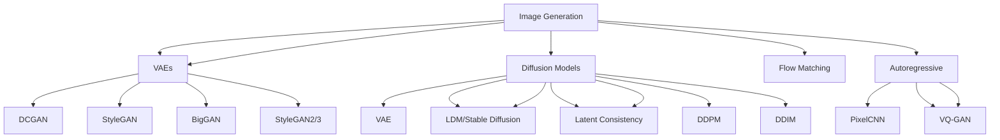

# Synthetic Image & Video Generation

A comprehensive guide to generating synthetic images and video using diffusion models, GANs, and related techniques.

---

## 1. Image Generation Overview



---

## 1. Diffusion Models (State of the Art)

### 1.1 Stable Diffusion (Latent Diffusion Models)
```python
# pip install diffusers transformers accelerate accelerate
from diffusers import StableDiffusionPipeline, StableDiffusionImg2ImgPipeline
from diffusers import StableDiffusionInpaintPipeline, StableDiffusionInpaintPipeline
import torch

# Text-to-Image
pipe = StableDiffusionPipeline.from_pretrained(
    "runwayml/stable-diffusion-v1-5",
    torch_dtype=torch.float16,
    variant="fp16",
    safety_checker=None
).to("cuda")

# Basic generation
prompt = "A photorealistic photo of a futuristic city at sunset, cinematic lighting"
images = pipe(
    prompt=prompt,
    num_inference_steps=50,
    guidance_scale=7.5,
    num_images_per_prompt=4
).images

# Save
for i, img in enumerate(images):
    img.save(f"output_{i}.png")
```

### 1.1 Stable Diffusion XL (SDXL)
```python
from diffusers import StableDiffusionXLPipeline

pipe = StableDiffusionXLPipeline.from_pretrained(
    "stabilityai/stable-diffusion-xl-base-1.0",
    torch_dtype=torch.float16,
    variant="fp16",
    use_safetensors=True
).to("cuda")

# Refiner for higher quality
refiner = StableDiffusionXLImg2ImgPipeline.from_pretrained(
    "stabilityai/stable-diffusion-xl-refiner-1.0",
    torch_dtype=torch.float16,
    variant="fp16",
    use_safetensors=True
).to("cuda")

# Two-stage: base + refiner
image = base(prompt, num_inference_steps=40, denoising_end=0.8, output_type="latent").images[0]
image = refiner(prompt=prompt, image=image, num_inference_steps=40, denoising_start=0.8).images[0]
```

### 2. ControlNet (Conditional Generation)
```python
from diffusers import ControlNetModel, StableDiffusionControlNetPipeline
from diffusers.utils import load_image
import cv2
import numpy as np
from PIL import Image

# Load ControlNet
controlnet = ControlNetModel.from_pretrained(
    "lllyasviel/sd-controlnet-canny",
    torch_dtype=torch.float16
)

pipe = StableDiffusionControlNetPipeline.from_pretrained(
    "runwayml/stable-diffusion-v1-5",
    controlnet=controlnet,
    torch_dtype=torch.float16
).to("cuda")

# Prepare control image (Canny edges)
image = load_image("input.png")
image = np.array(image)
canny = cv2.Canny(np.array(image), 100, 200)
canny = Image.fromarray(canny)

# Generate with control
images = pipe(
    prompt="A modern living room, photorealistic",
    image=canny,
    num_inference_steps=20,
    controlnet_conditioning_scale=0.5
).images[0]
```

### 2.1 ControlNet Variants
| ControlNet Type | Use Case | Model |
|--------------|----------|-------|
| Canny | Edge guidance | `lllyasviel/sd-controlnet-canny` |
| Depth | Depth map | `lllyasviel/sd-controlnet-depth` |
| Normal Map | Surface normals | `lllyasviel/sd-controlnet-normal` |
| Segmentation | Semantic segmentation | `lllyasviel/sd-controlnet-seg` |
| OpenPose | Human pose | `lllyasviel/sd-controlnet-openpose` |
| Scribble | Sketch guidance | `lllyasviel/sd-controlnet-scribble` |
| MLSD | Line detection | `lllyasviel/sd-controlnet-mlsd` |
| Normal Map | Surface normals | `lllyasviel/sd-controlnet-normal` |
| Tile | Texture tiling | `lllyasviel/sd-controlnet-tile` |

### 2. Inpainting & Outpainting
```python
# Inpainting
from diffusers import StableDiffusionInpaintPipeline

pipe = StableDiffusionInpaintPipeline.from_pretrained(
    "runwayml/stable-diffusion-inpainting",
    torch_dtype=torch.float16,
    variant="fp16"
).to("cuda")

# Prepare mask (white = area to inpaint)
mask = Image.open("mask.png").convert("RGB")
init_image = Image.open("input.png").convert("RGB")

images = pipe(
    prompt="A beautiful garden with flowers",
    image=init_image,
    mask_image=mask,
    num_inference_steps=50,
    strength=0.8
).images[0]

# Outpainting (extend image)
pipe = StableDiffusionInpaintPipeline.from_pretrained(
    "runwayml/stable-diffusion-inpainting",
    torch_dtype=torch.float16
).to("cuda")

# Extend image
mask = Image.new("RGB", (1024, 768), (0, 0, 0))
mask.paste(init_image, (256, 0))  # Place original on left
# White = area to generate
mask.paste((255, 255, 255), (512, 0, 1024, 768))

images = pipe(
    prompt="Extension of the landscape",
    image=init_image,
    mask_image=mask,
    num_inference_steps=50
).images[0]
```

---

## 2. Advanced Diffusion Techniques

### 1. LoRA (Low-Rank Adaptation)
```python
from diffusers import StableDiffusionPipeline
from diffusers import LoRAConfig, get_peft_model
from peft import LoraConfig, get_peft_model

# Load base model
pipe = StableDiffusionPipeline.from_pretrained(
    "runwayml/stable-diffusion-v1-5",
    torch_dtype=torch.float16
).to("cuda")

# Load LoRA weights
pipe.load_lora_weights("path/to/lora/weights", weight_name="pytorch_lora_weights.safetensors")

# Or train LoRA
from peft import LoraConfig, get_peft_model

lora_config = LoraConfig(
    r=16,
    lora_alpha=32,
    target_modules=["to_q", "to_k", "to_v", "to_out.0"],
    lora_dropout=0.1,
    bias="none",
    task_type="TEXT_TO_IMAGE"
)

model = get_peft_model(pipe.unet, lora_config)

# Train LoRA
# ... training loop ...

# Save
pipe.unet.save_pretrained("lora_weights")
```

### 2. DreamBooth (Personalization)
```python
# pip install diffusers[train]
from diffusers import DreamBoothPipeline

pipeline = DreamBoothPipeline.from_pretrained(
    "runwayml/stable-diffusion-v1-5",
    torch_dtype=torch.float16
).to("cuda")

# Train on custom images
pipeline = DreamBoothPipeline.from_pretrained(
    "runwayml/stable-diffusion-v1-5",
    torch_dtype=torch.float16
).to("cuda")

# Train on 3-5 images of a subject
pipeline.train(
    instance_images=["img1.jpg", "img2.jpg", "img3.jpg"],
    instance_prompt="a photo of sks dog",
    class_prompt="a photo of a dog",
    num_train_steps=1000,
    learning_rate=1e-6
)

# Generate
images = pipe("a photo of sks dog in a park").images
```

### 3. Textual Inversion
```python
# Textual Inversion - learn new token
from diffusers import TextualInversionPipeline

pipe = TextualInversionPipeline.from_pretrained(
    "runwayml/stable-diffusion-v1-5",
    torch_dtype=torch.float16
).to("cuda")

# Learn new token "<my-style>"
pipe.train_textual_inversion(
    prompt="a photo of <my-style>",
    placeholder_token="<my-style>",
    initializer_token="style",
    num_vectors=4,
    num_steps=5000
)

# Use
images = pipe("a painting in <my-style> style").images
```

---

## 2. Stable Video Diffusion

### 1. SVD (Stable Video Diffusion)
```python
from diffusers import StableVideoDiffusionPipeline
from diffusers.utils import load_image, export_to_video

pipe = StableVideoDiffusionPipeline.from_pretrained(
    "stabilityai/stable-video-diffusion-img2vid-xt",
    torch_dtype=torch.float16,
    variant="fp16"
).to("cuda")

image = load_image("input.png")

frames = pipe(
    image,
    num_frames=25,
    decode_chunk_size=8,
    motion_bucket_id=127,
    noise_aug_strength=0.1
).frames[0]

# Export
export_to_video(frames, "output.mp4", fps=7)
```

### 2. AnimateDiff
```python
# pip install animatediff
from diffusers import AnimateDiffPipeline, MotionAdapter, DDIMScheduler

adapter = MotionAdapter.from_pretrained("guoyww/animatediff-motion-adapter-v1-5-2")
pipe = AnimateDiffPipeline.from_pretrained(
    "runwayml/stable-diffusion-v1-5",
    motion_adapter=adapter,
    torch_dtype=torch.float16
).to("cuda")

pipe.scheduler = DDIMScheduler.from_pretrained(
    "runwayml/stable-diffusion-v1-5",
    subfolder="scheduler",
    clip_sample=False,
    timestep_spacing="linspace",
    beta_schedule="linear"
)

frames = pipe(
    prompt="A cat running in the park",
    num_frames=16,
    guidance_scale=7.5,
    num_inference_steps=25
).frames[0]

export_to_video(frames, "output.mp4", fps=8)
```

---

## 2. Video Generation Models

### 1. SVD (Stable Video Diffusion)
```python
# Already shown above - SVD img2vid
```

### 2. Video Diffusion Models
```python
# ModelScope T2V
# pip install modelscope
from modelscope.pipelines import pipeline
from modelscope.utils.constant import Tasks

pipe = pipeline(Tasks.text_to_video_synthesis, 'damo/cv_the-base_model_scope')
video_path = pipe({'text': 'A cat running in the park'})['output_video']

# ModelScope T2V
pipe = pipeline(Tasks.text_to_video_synthesis, 'damo/cv_the-base_model_scope')
result = pipe({'text': 'A cat running in the park'})
```

### 3. CogVideo
```python
# pip install cogvideo
from cogvideo import CogVideoPipeline

pipe = CogVideoPipeline.from_pretrained("THUDM/CogVideoX-2b")
video = pipe("A cat playing piano", num_frames=48, guidance_scale=6).frames[0]
```

### 4. Sora / Sora-like (OpenAI)
```python
# Not yet publicly available as of 2024
# Wait for OpenAI Sora API
```

---

## 3. ControlNet for Video

### 1. ControlNet-Video
```python
# ControlNet for video (ControlNet-Video)
from diffusers import ControlNetModel, StableDiffusionControlNetPipeline

controlnet = ControlNetModel.from_pretrained(
    "lllyasviel/sd-controlnet-canny",
    torch_dtype=torch.float16
)

pipe = StableDiffusionControlNetPipeline.from_pretrained(
    "runwayml/stable-diffusion-v1-5",
    controlnet=controlnet,
    torch_dtype=torch.float16
).to("cuda")

# Control with video frames
# Need ControlNet-Video for temporal consistency
```

---

## 5. 3D Generation

### 1. Text-to-3D
```python
# DreamFusion
# pip install threestudio
from threestudio import DreamFusionPipeline

pipe = DreamFusionPipeline.from_pretrained("ashawkey/imagedream")
mesh = pipe("a 3d model of a cute cat", num_inference_steps=5000)

# Magic3D
# pip install threestudio
# Similar API

# LRM (Large Reconstruction Model)
# pip install lrm
from lrm import LRMPipeline
pipe = LRMPipeline.from_pretrained("ashawkey/LRM")
mesh = pipe(image, num_views=4)
```

### 2. 3D Gaussian Splatting
```python
# 3D Gaussian Splatting
# pip install gsplat
from gsplat import GaussianSplatting

gs = GaussianSplatting()
gs.train(images, camera_poses)  # Train from multi-view images
gs.save_ply("output.ply")

# Text-to-3D with Gaussian Splatting
# pip install gsplat
from gsplat import GaussianSplattingTextTo3D

gs = GaussianSplattingTextTo3D()
mesh = gs.generate("a cute cat", num_iterations=10000)
```

### 3. TripoSR / LRM (Large Reconstruction Models)
```python
# LRM (Large Reconstruction Model)
# pip install lrm
from lrm import LRMPipeline

lrm = LRMPipeline.from_pretrained("ashawkey/LRM")
mesh = lrm(image, num_views=4, output_format="glb")
```

---

## 3. Audio & Speech (Cross-reference)

See `08_Audio_Speech.md` for:
- TTS (VALL-E, XTTS, Bark)
- Voice cloning
- Audio diffusion (AudioLDM, AudioLDM2)
- Music generation (MusicLM, AudioLDM, Stable Audio)

---

## 5. Evaluation Metrics for Images/Video

### 1. Image Quality Metrics
```python
from torchmetrics.image import (
    FrechetInceptionDistance,
    StructuralSimilarityIndexMeasure,
    PeakSignalNoiseRatio,
    LearnedPerceptualImagePatchSimilarity
)
from torchmetrics.image.fid import FrechetInceptionDistance
from torchmetrics.image.lpip import LearnedPerceptualImagePatchSimilarity

# FID
fid = FrechetInceptionDistance(feature=2048)
fid.update(real_images, real=True)
fid.update(fake_images, real=False)
fid_score = fid.compute()

# LPIPS (Learned Perceptual Image Patch Similarity)
lpips = LearnedPerceptualImagePatchSimilarity(net_type='vgg')
lpips_score = lpips(fake_images, real_images)

# SSIM
ssim = StructuralSimilarityIndexMeasure(data_range=1.0)
ssim_score = ssim(fake, real)

# PSNR
psnr = PeakSignalNoiseRatio()
psnr_val = psnr(fake, real)

# FID
fid = FrechetInceptionDistance(feature=2048)
fid.update(real_images, real=True)
fid.update(fake_images, real=False)
fid_score = fid.compute()
```

### 2. Video Metrics
```python
# FVD (Fréchet Video Distance)
from torchmetrics.video import FrechetVideoDistance
fvd = FrechetVideoDistance()
fvd.update(real_videos, real=True)
fvd.update(fake_videos, real=False)
fvd_score = fvd.compute()

# FVD with I3D features
from torchmetrics.video import FrechetVideoDistance
fvd = FrechetVideoDistance()
fvd.update(real_videos, real=True)
fvd.update(fake_videos, real=False)
fvd_score = fvd.compute()

# FVD with I3D
# FVD typically uses I3D features
```

### 3. Video Quality
```python
# FVD (Frechet Video Distance)
from torchmetrics.video import FrechetVideoDistance
fvd = FrechetVideoDistance()
fvd.update(real_videos, real=True)
fvd.update(fake_videos, real=False)
fvd_score = fvd.compute()

# Video FID (frame-level)
def video_fid(real_videos, fake_videos):
    # Extract frames, compute FID per frame, average
    pass
```

---

## 4. Evaluation Metrics for Generative Models

### 1. Image Quality Metrics
```python
from torchmetrics.image import (
    FrechetInceptionDistance,
    StructuralSimilarityIndexMeasure,
    PeakSignalNoiseRatio,
    LearnedPerceptualImagePatchSimilarity
)

# FID
fid = FrechetInceptionDistance(feature=2048)
fid.update(real_images, real=True)
fid.update(fake_images, real=False)
fid_score = fid.compute()

# LPIPS
lpips = LearnedPerceptualImagePatchSimilarity(net_type='vgg')
lpips_score = lpips(fake_images, real_images)

# SSIM
ssim = StructuralSimilarityIndexMeasure(data_range=1.0)
ssim_score = ssim(fake_images, real_images)

# PSNR
psnr = PeakSignalNoiseRatio()
psnr_val = psnr(fake_images, real_images)

# FID
fid = FrechetInceptionDistance(feature=2048)
fid.update(real_images, real=True)
fid.update(fake_images, real=False)
fid_score = fid.compute()
```

### 2. Video Metrics
```python
# FVD (Fréchet Video Distance)
from torchmetrics.video import FrechetVideoDistance
fvd = FrechetVideoDistance()
fvd.update(real_videos, real=True)
fvd.update(fake_videos, real=False)
fvd_score = fvd.compute()

# Video FID (frame-level)
def video_fid(real_videos, fake_videos):
    # Extract frames, compute FID per frame, average
    pass

# Video Quality Metrics
from torchmetrics.video import (
    FrechetVideoDistance,
    VideoMultiScaleSSIM,
    VideoMultiScaleSSIM
)
```

---

## 5. Evaluation & Quality Control

### 1. Fidelity Metrics
```python
from torchmetrics.image import (
    FrechetInceptionDistance,
    StructuralSimilarityIndexMeasure,
    PeakSignalNoiseRatio,
    LearnedPerceptualImagePatchSimilarity
)

def evaluate_images(real, fake):
    metrics = {}
    
    # FID
    fid = FrechetInceptionDistance(feature=2048)
    fid.update(real, real=True)
    fid.update(fake, real=False)
    metrics['FID'] = fid.compute().item()
    
    # LPIPS
    lpips = LearnedPerceptualImagePatchSimilarity(net_type='vgg')
    metrics['LPIPS'] = lpips(fake, real).item()
    
    # SSIM
    ssim = StructuralSimilarityIndexMeasure(data_range=1.0)
    metrics['SSIM'] = ssim(fake, real).item()
    
    # PSNR
    psnr = PeakSignalNoiseRatio()
    metrics['PSNR'] = psnr(fake, real).item()
    
    return metrics
```

---

## 5. Resources & References

### Key Papers
| Paper | Link |
|-------|------|
| Stable Diffusion | https://arxiv.org/abs/2112.10752 |
| SDXL | https://arxiv.org/abs/2307.01952 |
| ControlNet | https://arxiv.org/abs/2302.05543 |
| DreamBooth | https://arxiv.org/abs/2208.12242 |
| ControlNet | https://arxiv.org/abs/2302.05543 |
| Stable Video Diffusion | https://arxiv.org/abs/2311.15134 |
| AnimateDiff | https://arxiv.org/abs/2307.04725 |
| DreamFusion | https://arxiv.org/abs/2209.14988 |
| Magic3D | https://arxiv.org/abs/2211.10440 |
| LRM | https://arxiv.org/abs/2311.04400 |
| 3D Gaussian Splatting | https://arxiv.org/abs/2308.04079 |

### Key Repositories
| Repo | Description |
|------|-------------|
| diffusers | https://github.com/huggingface/diffusers |
| ComfyUI | https://github.com/comfyanonymous/ComfyUI |
| Automatic1111 | https://github.com/AUTOMATIC1111/stable-diffusion-webui |
| ComfyUI | https://github.com/comfyanonymous/ComfyUI |
| InvokeAI | https://github.com/invoke-ai/InvokeAI |
| threestudio | https://github.com/threestudio-project/threestudio |

---

*Last updated: 2024-11-05*
*Part of: Synthetic Data Knowledge Base*