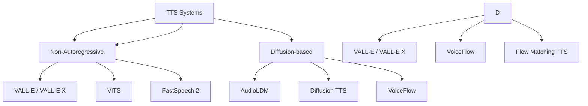

# Synthetic Audio & Speech Generation

A comprehensive guide to generating synthetic audio, speech, and music data.

---

## 1. Text-to-Speech (TTS)

### 1.1 Modern TTS Systems

| System | Type | Quality | Speed | Languages |
|--------|------|---------|-------|-----------|
| **VALL-E / VALL-E X** | Neural codec + LM | ★★★★★ | Slow | 100+ |
| **XTTS v2** | Transformer + VQ-VAE | ★★★★★ | Medium | 16+ |
| **Bark** | Transformer + VQ-VAE | ★★★★☆ | Medium | 13+ |
| **Tortoise TTS** | Autoregressive + Diffusion | ★★★★☆ | Slow | 13 |
| **VITS** | VITS (End-to-end) | ★★★★☆ | Fast | 100+ |
| **Piper** | Fast, lightweight | ★★★★☆ | Very Fast | 60+ |
| **MeloTTS** | VITS-based | ★★★★☆ | Fast | 15+ |
| **StyleTTS2** | Style transfer TTS | ★★★★☆ | Fast | 1 |

### 1.1 Modern TTS Architectures



---

## 1. Modern TTS Systems

### 1. VALL-E / VALL-E X (Microsoft)
```python
# VALL-E X (Cross-lingual)
# https://github.com/microsoft/VALL-E-X

# pip install vall-e-x
from vallex import Vallex

model = Vallex.from_pretrained("microsoft/vall-e-x")
audio = model.synthesize(
    text="Hello, this is a test.",
    prompt="Reference audio prompt",
    language="en"
)

# Zero-shot voice cloning
audio = model.synthesize(
    text="Hello world",
    prompt_audio="reference.wav",  # 3-second reference
    language="en"
)
```

### 2. XTTS v2 (Coqui)
```python
# pip install TTS
from TTS.api import TTS

tts = TTS("tts_models/multilingual/multi-dataset/xtts_v2").to("cuda")

# Zero-shot voice cloning
audio = tts.tts_to_file(
    text="Hello, this is a cloned voice.",
    speaker_wav="reference.wav",  # 3-10 second reference
    language="en",
    file_path="output.wav"
)

# Multi-lingual
audio = tts.tts_to_file(
    text="Bonjour le monde",
    speaker_wav="ref.wav",
    language="fr",
    file_path="output.wav"
)
```

### 3. Bark (Suno)
```python
# pip install bark
from bark import generate_audio, preload_models
from scipy.io.wavfile import write

preload_models()

# Text-to-speech with voice preset
audio = generate_audio(
    "Hello, this is a test of Bark text to speech.",
    history_prompt="v2/en_speaker_6"  # Preset voices
)

# Voice cloning
audio = generate_audio(
    "Hello world",
    history_prompt="path/to/reference.wav"
)
write_wav("output.wav", 24000, audio)
```

### 4. VITS (End-to-End TTS)
```python
# VITS - Parallel TTS
# pip install TTS
from TTS.api import TTS

tts = TTS("tts_models/en/vits", progress_bar=False).to("cuda")

# Fast inference
audio = tts.tts("Hello world!")
tts.tts_to_file(text="Hello", file_path="output.wav")
```

### 5. Piper (Fast, Lightweight)
```python
# pip install piper-tts
from piper import PiperVoice

voice = PiperVoice.load("en_US-lessac-medium")
audio = voice.synthesize("Hello world!")
with open("output.wav", "wb") as f:
    f.write(audio)
```

---

## 2. Voice Cloning / Conversion

### 1. VALL-E / VALL-E X (Microsoft)
```python
# VALL-E X - Zero-shot voice cloning
# https://github.com/microsoft/VALL-E-X

from vallex import Vallex

model = Vallex.from_pretrained("microsoft/vall-e-x")

# Zero-shot cloning (3-second reference)
audio = model.synthesize(
    text="Hello, this is a cloned voice.",
    prompt_audio="reference.wav",  # 3+ seconds
    language="en"
)

# Cross-lingual
audio = model.synthesize(
    text="Bonjour le monde",
    prompt_audio="en_speaker.wav",
    language="fr"  # French output from English reference
)
```

### 2. XTTS v2 (Coqui)
```python
from TTS.api import TTS

tts = TTS("tts_models/multilingual/multi-dataset/xtts_v2").to("cuda")

# Voice cloning
tts.tts_to_file(
    text="Hello, this is my cloned voice.",
    speaker_wav="reference.wav",  # 3-10 second reference
    language="en",
    file_path="output.wav"
)

# Multi-lingual
tts.tts_to_file(
    text="Bonjour le monde",
    speaker_wav="ref.wav",
    language="fr",
    file_path="fr_output.wav"
)
```

### 3. OpenVoice (MyShell)
```python
# pip install openvoice
from openvoice import OpenVoice

converter = OpenVoiceConverter()

# Tone color cloning
audio = converter.convert(
    text="Hello world",
    reference_speaker="reference.wav",
    target_language="en"
)

# Cross-lingual
audio = openvoice.convert(
    text="Bonjour",
    source_language="en",
    target_language="fr",
    reference_speaker="ref.wav"
)
```

### 4. RVC (Retrieval-based Voice Conversion)
```python
# pip install rvc-python
from rvc import RVC

rvc = RVC(model_path="model.pth", index_path="index.index")

# Voice conversion
audio = rvc.infer(
    input_audio="input.wav",
    target_speaker="target_speaker",
    pitch_shift=0,  # semitones
    f0_method="rmvpe"
)
```

---

## 2. Audio Generation (Non-Speech)

### 1. AudioLDM / AudioLDM 2
```python
# pip install audioldm
from audioldm import AudioLDM

# AudioLDM - Text-to-Audio
model = AudioLDM()
audio = model.generate(
    prompt="A bird singing in the forest with gentle wind",
    duration=10.0,
    guidance_scale=3.5
)

# AudioLDM 2 (better quality)
from audioldm import AudioLDM2
model = AudioLDM2()
audio = model.generate(
    "Piano music with jazz style",
    duration=30.0,
    guidance_scale=3.5
)
```

### 2. Music Generation
```python
# MusicLM (Google) - not open source
# MusicGen (Meta) - Open source alternative

# pip install transformers
from transformers import MusicgenForConditionalGeneration, AutoProcessor

processor = AutoProcessor.from_pretrained("facebook/musicgen-large")
model = MusicgenForConditionalGeneration.from_pretrained("facebook/musicgen-large")

inputs = processor(
    text=["Upbeat jazz piano with drums"],
    padding=True,
    return_tensors="pt"
)
audio = model.generate(**inputs, max_new_tokens=512)

# MusicGen parameters
audio = model.generate(
    **inputs,
    max_new_tokens=256,
    do_sample=True,
    temperature=1.0,
    top_k=250,
    top_p=0.95
)
```

### 3. Stable Audio / AudioLDM 2
```python
# Stable Audio (Stability AI)
# pip install stable-audio
from stable_audio import StableAudio

model = StableAudioPipeline.from_pretrained("stabilityai/stable-audio-open-1.0")
audio = model(
    prompt="Ambient electronic music with synthesizers",
    duration=30.0,
    num_inference_steps=50
)

# AudioLDM 2
from audioldm2 import AudioLDM2
model = AudioLDM2.from_pretrained("cvssp/audioldm2")
audio = model.generate("Acoustic guitar folk song", duration=30)
```

### 4. MusicLM / MusicGen
```python
# MusicGen (Meta)
from transformers import MusicgenForConditionalGeneration, AutoProcessor

processor = AutoProcessor.from_pretrained("facebook/musicgen-large")
model = MusicgenForConditionalGeneration.from_pretrained("facebook/musicgen-large")

inputs = processor(
    text=["Upbeat electronic dance music with heavy bass"],
    padding=True,
    return_tensors="pt"
)

audio = model.generate(**inputs, max_new_tokens=512)
```

---

## 3. Voice Conversion / Conversion

### 1. FreeVC (Free Voice Conversion)
```python
# pip install freevc
from freevc import FreeVC

vc = FreeVC()
# Source -> Target voice conversion
converted = vc.convert(
    source_audio="source.wav",
    target_speaker="target_ref.wav"
)
```

### 2. RVC (Retrieval-based Voice Conversion)
```python
# pip install rvc
from rvc import RVC

rvc = RVC(
    model_path="model.pth",
    index_path="index.index"
)

# Voice conversion
converted = rvc.convert(
    input_audio="input.wav",
    target_speaker="target_speaker",
    pitch_shift=0,  # semitones
    f0_method="rmvpe",  # 'crepe', 'pm', 'harvest', 'rmvpe'
    filter_radius=3,
    rms_mix_rate=0.25
)

# Real-time
rvc.infer_realtime(
    input_device=0,
    output_device=1,
    target_speaker="target"
)
```

### 3. So-VITS-SVC
```python
# pip install sovits-svc
from sovits_svc import SoVITS

svc = SoVITS(
    model_path="model.pth",
    config_path="config.json"
)

# Inference
audio = svc.infer(
    input_audio="input.wav",
    speaker_id=0,  # Speaker ID
    pitch_shift=0,  # semitones
    f0_method="rmvpe"
)
```

---

## 4. Audio Codecs / Tokenization

### 1. EnCodec (Meta)
```python
# pip install encodec
from encodec import EncodecModel
import torchaudio

# Load model
model = EncodecModel.encodec_model_24khz()
model.set_target_bandwidth(6.0)  # 6 kbps

# Encode
wav, sr = torchaudio.load("audio.wav")
codes = model.encode(wav.unsqueeze(0))

# Decode
reconstructed = model.decode(codes)
```

### 2. DAC (Descript Audio Codec)
```python
# pip install dac
import dac

model = dac.DAC.load("dac_44khz")
# or dac_16khz, dac_24khz, dac_44khz

# Encode
codes = model.encode(audio_signal)
# codes shape: (B, codebooks, time)

# Decode
reconstructed = model.decode(codes)
```

### 3. FunCodec / EnCodec
```python
# FunCodec (better quality)
# pip install funcodec
from funasr import AutoModel

model = AutoModel(model="funasr/codec/encodec_24khz")
codes = model.encode(audio)
reconstructed = model.decode(codes)
```

---

## 2. Music Generation

### 1. MusicGen (Meta)
```python
from transformers import MusicgenForConditionalGeneration, AutoProcessor

processor = AutoProcessor.from_pretrained("facebook/musicgen-large")
model = MusicgenForConditionalGeneration.from_pretrained("facebook/musicgen-large")

inputs = processor(
    text=["Upbeat electronic dance music with heavy bass"],
    padding=True,
    return_tensors="pt"
)

audio = model.generate(**inputs, max_new_tokens=512, do_sample=True)
```

### 2. MusicLM (Google) - Not open source
```python
# MusicLM not open source, alternatives:
# - MusicGen (Meta)
# - AudioLDM 2
# - Stable Audio (Stability AI)
# - MusicLM (Google, API only)
```

### 3. Stable Audio (Stability AI)
```python
# pip install stable-audio
from stable_audio import StableAudioPipeline

pipe = StableAudioPipeline.from_pretrained("stabilityai/stable-audio-open-1.0")
audio = pipe(
    prompt="Ambient electronic music with synthesizers",
    num_inference_steps=100,
    audio_end_in_s=30.0
).audios[0]
```

---

## 4. Voice Cloning / Conversion

### 1. VALL-E / VALL-E X
```python
# VALL-E X (Microsoft)
# https://github.com/microsoft/VALL-E-X

from vallex import Vallex

model = Vallex.from_pretrained("microsoft/vall-e-x")

# Zero-shot cloning
audio = model.synthesize(
    text="Hello, this is a cloned voice.",
    prompt_audio="reference.wav",  # 3+ seconds
    language="en"
)

# Cross-lingual
audio = model.synthesize(
    text="Bonjour le monde",
    prompt_audio="english_speaker.wav",
    language="fr"  # French output from English reference
)
```

### 2. XTTS v2 (Coqui)
```python
from TTS.api import TTS

tts = TTS("tts_models/multilingual/multi-dataset/xtts_v2").to("cuda")

# Clone voice
tts.tts_to_file(
    text="Hello, this is my cloned voice.",
    speaker_wav="reference.wav",
    language="en",
    file_path="output.wav"
)

# Multi-lingual
tts.tts_to_file(
    text="Bonjour le monde",
    speaker_wav="ref.wav",
    language="fr",
    file_path="fr_output.wav"
)
```

### 3. OpenVoice (MyShell)
```python
# pip install openvoice
from openvoice import OpenVoice

converter = OpenVoice()
audio = converter.convert(
    text="Hello world",
    reference_speaker="ref.wav",
    target_language="en"
)
```

---

## 3. Evaluation & Quality Metrics

### 1. Speech Quality Metrics
```python
import torch
import torchaudio
from speechbrain.inference import Separation, Enhancement

# PESQ (Perceptual Evaluation of Speech Quality)
from pesq import pesq
pesq_score = pesq(fs=16000, ref=ref_wav, deg=gen_wav, mode='wb')

# STOI (Short-Time Objective Intelligibility)
from pystoi import stoi
stoi_score = stoi(ref_wav, gen_wav, fs=16000)

# SI-SDR (Scale-Invariant SDR)
def si_sdr(ref, deg):
    # Scale-invariant SDR
    s_target = (np.sum(ref * deg) / np.sum(deg**2)) * deg
    e_noise = deg - s_target
    return 10 * np.log10(np.sum(s_target**2) / np.sum((deg - s_target)**2))

# DNSMOS (Microsoft)
# pip install dnsmos
from dnsmos import compute_dnsmos
score = compute_dnsmos(audio_file)
```

### 2. Speaker Similarity
```python
# Speaker embedding similarity
from speechbrain.inference import SpeakerRecognition

verification = SpeakerRecognition.from_hparams(
    source="speechbrain/spkrec-ecapa-voxceleb",
    savedir="pretrained_models/spkrec"
)

score = verification.verify_batch(ref_wav, gen_wav)
similarity = verification.score(ref_emb, gen_emb)
```

---

## 3. Real-time / Streaming

### 1. Streaming TTS
```python
# Streaming TTS with VITS
tts = TTS("tts_models/en/vits").to("cuda")

def stream_tts(text_chunks):
    for chunk in text_chunks:
        audio = tts.tts(chunk)
        yield chunk  # Stream to client
```

### 2. Low-Latency TTS
```python
# Piper (fast, low latency)
# pip install piper-tts
from piper import PiperVoice

voice = PiperVoice.load("en_US-lessac-medium")
audio = voice.synthesize_stream_raw("Hello world")

# Streaming
for chunk in voice.synthesize_stream("Hello world this is a test"):
    yield chunk
```

---

## 5. Evaluation Metrics

### 1. Speech Quality
```python
# PESQ (Perceptual Evaluation of Speech Quality)
from pesq import pesq
pesq_score = pesq(fs=16000, ref=ref_wav, deg=gen_wav, mode='wb')

# STOI (Short-Time Objective Intelligibility)
from pystoi import stoi
stoi_score = stoi(ref_wav, gen_wav, fs=16000)

# SI-SDR (Scale-Invariant SDR)
def si_sdr(ref, deg):
    s_target = (np.sum(ref * deg) / np.sum(deg**2)) * deg
    e_noise = deg - s_target
    return 10 * np.log10(np.sum(s_target**2) / np.sum(e_noise**2))

# DNSMOS (Microsoft)
from dnsmos import compute_dnsmos
score = compute_dnsmos(audio_file)
```

### 2. Speaker Similarity
```python
from speechbrain.inference import SpeakerRecognition

verification = SpeakerRecognition.from_hparams(
    source="speechbrain/spkrec-ecapa-voxceleb",
    savedir="pretrained_models/spkrec"
)

# Verification
score = verification.verify_batch(ref_wav, gen_wav)

# Embedding similarity
ref_emb = verification.encode_batch(ref_wav)
gen_emb = verification.encode_batch(gen_wav)
sim = cosine_similarity(ref_emb, gen_emb)
```

---

## 5. Resources

### Key Papers
| Paper | Link |
|-------|------|
| VALL-E | https://arxiv.org/abs/2301.02111 |
| VALL-E X | https://arxiv.org/abs/2303.03926 |
| XTTS v2 | https://github.com/coqui-ai/TTS |
| Bark | https://github.com/suno-ai/bark |
| AudioLDM | https://arxiv.org/abs/2301.12503 |
| MusicGen | https://arxiv.org/abs/2306.05284 |
| AudioLDM 2 | https://arxiv.org/abs/2308.02612 |
| Stable Audio | https://arxiv.org/abs/2307.01639 |
| VALL-E | https://arxiv.org/abs/2301.02111 |
| XTTS v2 | https://github.com/coqui-ai/TTS |

### Key Repositories
| Repo | Description |
|-------|-------------|
| Coqui TTS | https://github.com/coqui-ai/TTS |
| Bark | https://github.com/suno-ai/bark |
| AudioLDM | https://github.com/haoheliu/AudioLDM |
| MusicGen | https://github.com/facebookresearch/audiocraft |
| Stable Audio | https://github.com/Stability-AI/stable-audio-tools |

---

*Last updated: 2024-11-05*
*Part of: Synthetic Data Knowledge Base*