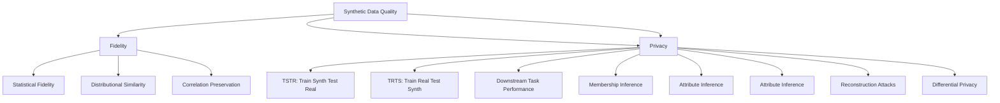

# Synthetic Data Evaluation & Quality Assessment

A comprehensive reference for evaluating synthetic data quality across fidelity, utility, and privacy dimensions.

---

## 1. Evaluation Framework: The FUP Triangle



---

## 1. Fidelity Metrics (Statistical Similarity)

### 1.1 Univariate Distribution Comparison

```python
from scipy.stats import ks_2samp, wasserstein_distance, jensenshannon
import numpy as np

def fidelity_univariate(real_col, synth_col):
    """Comprehensive univariate fidelity metrics"""
    metrics = {}
    
    # Kolmogorov-Smirnov Test
    ks_stat, p_val = ks_2samp(real_col.dropna(), synth_col.dropna())
    metrics['ks_statistic'] = ks_stat
    metrics['ks_p_value'] = p_val
    metrics['ks_pass'] = p_val > 0.05
    
    # Wasserstein Distance (Earth Mover's Distance)
    metrics['wasserstein'] = wasserstein_distance(real, synth)
    
    # Jensen-Shannon Divergence
    # Bin continuous data for JS divergence
    bins = np.histogram_bin_edges(np.concatenate([real, synth]), bins=50)
    hist_real, _ = np.histogram(real, bins=bins, density=True)
    hist_syn, _ = np.histogram(syn, bins=bins, density=True)
    metrics['js_divergence'] = jensenshannon(hist_real, hist_syn)
    
    # Moments
    metrics['mean_diff'] = abs(np.mean(real) - np.mean(syn))
    metrics['std_ratio'] = np.std(syn) / np.std(real) if np.std(real) > 0 else np.inf
    metrics['skew_diff'] = abs(skew(real) - skew(syn))
    metrics['kurtosis_diff'] = abs(kurtosis(real) - kurtosis(syn))
    
    # Quantile comparison
    for q in [0.01, 0.05, 0.25, 0.5, 0.75, 0.95, 0.99]:
        q_real = np.percentile(real, q*100)
        q_syn = np.percentile(syn, q*100)
        metrics[f'quantile_{int(q*100)}_diff'] = abs(q_real - q_syn)
    
    return metrics
```

### 2. Multivariate Fidelity

```python
def fidelity_multivariate(real_df, synth_df, numeric_cols=None):
    """Multivariate fidelity assessment"""
    if numeric_cols is None:
        numeric_cols = real_df.select_dtypes(include=[np.number]).columns
    
    real_num = real_df[numeric_cols].dropna()
    synth_num = synthetic[numeric_cols].dropna()
    
    metrics = {}
    
    # Correlation Matrix Difference
    corr_real = real_df.corr()
    corr_syn = synth_df.corr()
    corr_diff = np.abs(corr_real - corr_syn)
    metrics['corr_max_diff'] = corr_diff.values.max()
    metrics['corr_mean_abs_diff'] = corr_diff.abs().mean().mean()
    metrics['corr_frobenius'] = np.linalg.norm(corr_real - corr_syn, 'fro')
    
    # Covariance Matrix Distance
    cov_real = np.cov(real_df.T)
    cov_syn = np.cov(synth_df.T)
    metrics['cov_frobenius'] = np.linalg.norm(cov_real - cov_syn, 'fro')
    
    # Maximum Mean Discrepancy (MMD)
    from sklearn.metrics import pairwise
    mmd = mmd_rbf(real_data.values, synth_data.values)
    metrics['mmd_rbf'] = mmd
    
    # Classifier Two-Sample Test (C2ST)
    from sklearn.model_selection import cross_val_predict
    from sklearn.linear_model import LogisticRegression
    X = np.vstack([real_data, synth_data])
    y = np.hstack([np.ones(len(real)), np.zeros(len(synth))])
    clf = LogisticRegressionCV(cv=5, random_state=42).fit(X, y)
    preds = cross_val_predict(LogisticRegression(), X, y, cv=5, method='predict_proba')[:,1]
    auc = roc_auc_score(y, preds)
    metrics['c2st_auc'] = auc  # 0.5 = indistinguishable
    
    return metrics
```

### 3. Categorical Fidelity
```python
def categorical_fidelity(real_cat, synth_cat):
    """Comprehensive categorical fidelity metrics"""
    from scipy.stats import chisquare
    
    metrics = {}
    
    # Value counts comparison
    real_counts = real_cat.value_counts(normalize=True)
    syn_counts = synth_cat.value_counts(normalize=True)
    
    # Align categories
    all_cats = set(real_counts.index) | set(syn_counts.index)
    real_probs = real_counts.reindex(all_cats, fill_value=0)
    syn_probs = syn_counts.reindex(all_cats, fill_value=0)
    
    # Chi-square
    chi2, p = chisquare(f_obs=syn_counts * len(syn), f_exp=real_counts * len(syn))
    metrics['chi2_stat'] = chi2
    metrics['chi2_p'] = p_val
    
    # Jensen-Shannon
    from scipy.spatial.distance import jensenshannon
    metrics['js_divergence'] = jensenshannon(real_probs, syn_probs)
    
    # Total Variation Distance
    tvd = 0.5 * np.abs(real_probs - syn_probs).sum()
    metrics['tvd'] = tvd
    
    # Per-category
    for cat in all_cats:
        real_p = real_probs.get(cat, 0)
        syn_p = syn_probs.get(cat, 0)
        metrics[f'diff_{cat}'] = abs(real_p - syn_p)
    
    return metrics
```

---

## 2. Utility Metrics (Downstream Task Performance)

### 1. Train on Synthetic, Test on Real (TSTR)
```python
def tstr_evaluation(synth_train, real_test, model_class, **kwargs):
    """
    Train on Synthetic, Test on Real (TSTR)
    Gold standard for utility evaluation
    """
    # Train on synthetic
    model = model_class(**kwargs)
    model.fit(synth_X, synth_y)
    
    # Test on real
    score = model.score(X_test_real, y_test_real)
    return score

def tstr_evaluation(synth_data, real_train, real_test, model_class, **kwargs):
    """Train on synthetic, test on real"""
    model = model_class()
    model.fit(synth_X, synth_y)
    return model.score(X_test_real, y_test_real)

# Compare with real-trained baseline
real_model = model_class().fit(X_real_train, y_real_train)
real_score = real_model.score(X_test, y_test)

synth_model = model_class().fit(synth_X, synth_y)
synth_score = synth_model.score(X_test, y_test)

utility_preservation = synth_score / real_score  # Should be ~1.0
```

### 2. Train on Real, Test on Synthetic (TRTS)
```python
def trts_evaluation(model, synth_test, real_test):
    """Train on Real, Test on Synthetic (TRTS)"""
    model.fit(X_real_train, y_train)
    synth_score = model.score(X_synth_test, y_synth_test)
    real_score = model.score(X_test, y_test)
    return synth_score / real_score  # Should be ~1.0
```

### 3. Cross-Validation with Synthetic Data
```python
def cross_val_synthetic(synth_data, real_data, model_class, cv=5):
    """Cross-validation with mixed real/synthetic"""
    from sklearn.model_selection import cross_val_score
    
    # Train on synthetic, validate on real
    scores = cross_val_score(model, synth_X, synth_y, cv=5, scoring='roc_auc')
    
    # Compare with real-only CV
    real_scores = cross_val_score(model, X_real, y_real, cv=5)
    
    return {
        'synthetic_cv_mean': synth_scores.mean(),
        'real_cv_mean': real_scores.mean(),
        'ratio': synth_scores.mean() / real_scores.mean()
    }
```

### 4. Downstream Task Utility
```python
def downstream_utility(real_train, synth_data, real_test, tasks):
    """Evaluate synthetic data on multiple downstream tasks"""
    results = {}
    
    for task_name, task_config in tasks.items():
        model = task_config['model']()
        
        # Train on synthetic
        synth_model = model.fit(synth_X, synth_y)
        synth_score = model.score(X_test_real, y_test)
        
        # Train on real (upper bound)
        real_model = model.fit(X_train_real, y_train)
        real_score = real_model.score(X_test, y_test)
        
        results[task] = {
            'synthetic_score': synth_score,
            'real_score': real_score,
            'utility_ratio': synth_score / real_score if real_score > 0 else 0
        }
    
    return results
```

---

## 2. Privacy Metrics

### 1. Membership Inference Attacks
```python
def membership_inference_attack(model, train_data, test_data, synthetic_data):
    """
    Membership Inference Attack (MIA)
    Trains attacker to distinguish training data from synthetic
    """
    # Prepare attack data
    train_data = np.vstack([train_data, synthetic])
    labels = np.hstack([np.ones(len(train)), np.zeros(len(synthetic))])
    
    # Train attack model
    attack_model = RandomForestClassifier(n_estimators=100)
    attack_model.fit(attack_X, labels)
    
    # Evaluate on holdout
    test_X = np.vstack([test_real, synthetic_test])
    test_labels = np.hstack([np.ones(len(test_real)), np.zeros(len(synth_test))])
    
    pred = attack_model.predict_proba(test_X)[:, 1]
    auc = roc_auc_score(test_labels, pred_proba)
    
    return {
        'mia_auc': auc,
        'privacy_risk': 'HIGH' if auc > 0.7 else 'MODERATE' if auc > 0.6 else 'LOW'
    }

# Shadow Model Attack (more realistic)
def shadow_model_attack(target_model, shadow_models, target_data, shadow_data):
    """Train shadow models to mimic target, then attack"""
    pass
```

### 2. Attribute Inference Attack
```python
def attribute_inference_attack(model, X_test, sensitive_col, known_cols):
    """
    Can attacker infer sensitive attribute from other features?
    """
    # Train attack model
    attack_model = RandomForestClassifier()
    attack_model.fit(X_train[known_cols], X_train[target_col])
    
    # Attack
    preds = attack_model.predict(X_test[known_cols])
    acc = accuracy_score(X_test[target_col], preds)
    
    return {
        'attribute_inference_accuracy': accuracy,
        'baseline': max(y_train.value_counts()) / len(y),
        'improvement': accuracy - baseline
    }
```

### 3. Attribute Inference Attack
```python
def attribute_inference_attack(model, X_test, sensitive_col, known_cols):
    """
    Can we predict sensitive attribute from other features?
    """
    # Train attack model on synthetic
    attack_model = RandomForestClassifier()
    attack_model.fit(synth[known_cols], synth[sensitive_col])
    
    # Attack on real test data
    preds = attack_model.predict(X_test[synth_cols])
    acc = accuracy_score(X_test[target_col], preds)
    
    # Compare with baseline (majority class)
    baseline = max(y.value_counts()) / len(y)
    
    return {
        'accuracy': acc,
        'baseline': baseline,
        'leakage': accuracy - baseline
    }
```

### 4. Reconstruction / Inversion Attacks
```python
# Model Inversion Attack
def model_inversion_attack(model, target_class, n_iterations=1000):
    """Reconstruct input that maximizes target class probability"""
    x = torch.randn(1, *input_shape, requires_grad=True)
    optimizer = torch.optim.Adam([x], lr=0.1)
    
    for i in range(iterations):
        loss = -model(x)[target_class]
        loss.backward()
        optimizer.step()
    
    return x.detach()

# Attribute inference via model inversion
def model_inversion_attack(model, target_class, max_iter=1000):
    x = torch.randn(1, input_dim, requires_grad=True)
    optimizer = torch.optim.Adam([x], lr=0.1)
    
    for _ in range(max_iter):
        logits = model(x)
        loss = -logits[0, target_class]
        loss.backward()
        optimizer.step()
        optimizer.zero_grad()
    
    return x.detach()
```

---

## 3. Anonymization Metrics (Traditional)

### 1. k-Anonymity
```python
def check_k_anonymity(df, quasi_identifiers, k=5):
    """Check k-anonymity"""
    grouped = df.groupby(quasi_identifiers).size()
    min_group = grouped.min()
    return {
        'k_anonymity': grouped.min(),
        'passes': grouped.min() >= k,
        'violations': (grouped < k).sum(),
        'suppressed_rows': (grouped < k).sum()
    }

# Generalization for k-anonymity
def generalize_for_k_anonymity(df, quasi_ids, k=5):
    """Generalize quasi-identifiers to achieve k-anonymity"""
    # Implement generalization hierarchies
    pass
```

### 2. l-Diversity
```python
def check_l_diversity(df, quasi_ids, sensitive_col, l=3):
    """Check l-diversity"""
    groups = df.groupby(list(quasi_identifiers))
    diverse = True
    min_diversity = float('inf')
    
    for _, group in groups:
        distinct = group[sensitive_col].nunique()
        min_diversity = min(min_diversity, distinct)
        if distinct < l:
            diverse = False
    
    return {
        'l_diverse': diverse,
        'min_diversity': min_diversity
    }
```

### 3. t-Closeness
```python
def check_t_closeness(df, quasi_ids, sensitive_col, t=0.2):
    """Check t-closeness using Earth Mover's Distance"""
    from scipy.stats import wasserstein_distance
    
    global_dist = df[sensitive_col].value_counts(normalize=True)
    groups = df.groupby(list(quasi_identifiers))
    
    max_dist = 0
    for _, group in groups:
        group_dist = group[sensitive_col].value_counts(normalize=True)
        emd = wasserstein_distance(global_dist, group_dist)
        if emd > t:
            return False, emd
    
    return True, max_emd
```

---

## 3. Data Quality Dimensions

### 1. Completeness
```python
def completeness_report(df):
    """Comprehensive completeness report"""
    report = {}
    for col in df.columns:
        total = len(df)
        missing = df[col].isnull().sum()
        pct = missing / len(df) * 100
        report[col] = {'missing': missing, 'pct': pct, 'complete': pct < 5}
    return pd.DataFrame(report).T

# Completeness by group
df.groupby('category').apply(lambda g: g.isnull().mean())
```

### 2. Consistency
```python
def consistency_checks(df):
    checks = {}
    
    # Cross-field validation
    if 'age' in df and 'birth_date' in df:
        calc_age = (pd.Timestamp.now() - pd.to_datetime(df['birth_date'])).dt.days / 365.25
        age_diff = abs(df['age'] - calc_age)
        checks['age_consistency'] = (age_diff <= 1).mean()
    
    # Referential integrity
    if 'user_id' in df and 'order_id' in df:
        # Check foreign keys
        pass
    
    return checks
```

### 3. Validity
```python
def validity_checks(df, rules):
    """Custom validity rules"""
    violations = {}
    for col, rule in rules.items():
        if callable(rule):
            violations = df[~df[col].apply(rule)]
        else:
            violations = df[~df[col].isin(rule)]
        violations[col] = len(violations)
    return violations
```

---

## 5. Visualization for Quality Assessment

### 1. Distribution Comparison
```python
import matplotlib.pyplot as plt
import seaborn as sns

def plot_distribution_comparison(real, synth, cols, n_cols=3):
    n_cols = len(cols)
    fig, axes = plt.subplots((len(cols) + 2) // 3, 3, figsize=(15, 5*len(cols)//3))
    axes = axes.flatten()
    
    for i, col in enumerate(cols):
        ax = axes[i]
        sns.histplot(real[col], alpha=0.5, label='Real', bins=30, stat='density', ax=axes[i])
        sns.histplot(synth[col], alpha=0.5, label='Synth', bins=30, stat='density', ax=axes[i])
        axes[i].set_title(col)
        axes[i].legend()
    
    plt.tight_layout()
    return fig
```

### 2. Correlation Heatmap Comparison
```python
def plot_correlation_comparison(real, synth):
    fig, axes = plt.subplots(1, 3, figsize=(18, 5))
    
    sns.heatmap(real.corr(), ax=axes[0], cmap='RdBu_r', center=0, vmin=-1, vmax=1)
    axes[0].set_title('Real')
    
    sns.heatmap(synth.corr(), ax=axes[1], cmap='RdBu_r', center=0, vmin=-1, vmax=1)
    axes[1].set_title('Synthetic')
    
    diff = real.corr() - synth.corr()
    sns.heatmap(diff, ax=axes[2], cmap='RdBu_r', center=0, vmin=-1, vmax=1)
    axes[2].set_title('Difference')
    
    plt.tight_layout()
    return fig
```

---

## 6. Automated Quality Reports

### 1. Automated Report Generation
```python
from ydata_profiling import ProfileReport
from evidently.report import Report
from evidently.metric_preset import DataDriftPreset, DataQualityPreset

# ydata-profiling (formerly pandas-profiling)
profile = ProfileReport(df, title="Real Data Report")
profile.to_file("real_report.html")

profile_syn = ProfileReport(syn_df, title="Synthetic Data Report")
profile_syn.to_file("syn_report.html")

# Comparison
from pandas_profiling.compare import compare
comparison = compare(profile_real, profile_syn)
comparison.to_file("comparison.html")

# Evidently AI
from evidently.report import Report
from evidently.metric_preset import DataDriftPreset, DataQualityPreset

report = Report(metrics=[DataDriftPreset(), DataQualityPreset()])
report.run(reference_data=real_df, current_data=syn_df)
report.save_html("evidently_report.html")

# Custom test suite
from evidently.test_suite import TestSuite
from evidently.tests import *

suite = TestSuite(tests=[
    TestNumberOfDriftedColumns(threshold=0.1),
    TestColumnDrift(column='age', stattest='ks', threshold=0.05),
    TestNumberOfMissingValues(),
    TestColumnValueMinMax(column='age', min=0, max=120),
])
suite.run(reference_data=real, current_data=syn)
suite.save_html("test_suite.html")
```

---

## 7. Automated Quality Dashboard

```python
def generate_quality_dashboard(real_df, synth_df, target_col=None):
    """Generate comprehensive quality dashboard"""
    
    dashboard = {
        'fidelity': {},
        'utility': {},
        'privacy': {},
        'overall_score': 0
    }
    
    # 1. Fidelity
    fid = fidelity_metrics(real, synth)
    dashboard['fidelity'] = fid
    
    # 2. Utility
    if target_col and target_col in real.columns:
        util = utility_metrics(real, synth, target_col)
        dashboard['utility'] = util
    
    # 3. Privacy
    priv = privacy_audit(real, synth)
    dashboard['privacy'] = priv
    
    # Overall score
    weights = {'fidelity': 0.4, 'utility': 0.4, 'privacy': 0.2}
    overall = sum(dashboard[k]['score'] * w for k, w in weights.items())
    dashboard['overall'] = overall
    
    # Generate HTML report
    return generate_html_report(dashboard)
```

---

## 9. Automated Quality Pipeline

```python
class SyntheticDataQualityPipeline:
    def __init__(self, thresholds=None):
        self.thresholds = thresholds or {
            'fidelity_score': 0.9,
            'utility_ratio': 0.95,
            'mia_auc': 0.55,
            'attr_inf_auc': 0.6,
            'k_anonymity': 5
        }
    
    def run(self, real_data, synthetic_data, metadata=None):
        results = {}
        
        # 1. Fidelity
        results['fidelity'] = self.evaluate_fidelity(real, synth)
        
        # 2. Utility
        results['utility'] = self.evaluate_utility(real, synth)
        
        # 3. Privacy
        results['privacy'] = self.evaluate_privacy(real, synth)
        
        # 4. Overall
        results['passed'] = self.check_thresholds(results)
        results['summary'] = self.generate_summary(results)
        
        return results
    
    def check_thresholds(self, results):
        checks = {
            'fidelity': results['fidelity']['score'] >= self.thresholds['fidelity_score'],
            'utility': results['utility']['ratio'] >= self.thresholds['utility_ratio'],
            'mia': results['privacy']['mia_auc'] <= self.thresholds['mia_auc'],
            'attr_inf': results['privacy']['attr_inf_auc'] <= self.thresholds['attr_inf_auc'],
        }
        return all(checks.values())
```

---

## 10. Best Practices Checklist

```markdown
## Evaluation Checklist

### Pre-Generation
- [ ] Define quality thresholds (fidelity, utility, privacy)
- [ ] Profile real data (distributions, correlations, missingness)
- [ ] Define privacy budget (ε, δ) and threat model
- [ ] Select evaluation metrics per dimension

### During Generation
- [ ] Monitor fidelity metrics during training
- [ ] Track utility on validation set
- [ ] Monitor privacy budget consumption

### Post-Generation
- [ ] **Fidelity**: KS < 0.1, JS < 0.1, Corr diff < 0.1
- [ ] **Utility**: TSTR/TRTS ratio > 0.95
- [ ] **Privacy**: MIA AUC < 0.55, Attr Inf AUC < 0.6
- [ ] **Anonymity**: k ≥ 5, l-diversity ≥ 3, t-closeness < 0.2

### Red Flags
- [ ] KS statistic > 0.1 for key variables
- [ ] Correlation difference > 0.1
- [ ] TSTR utility ratio < 0.9
- [ ] MIA AUC > 0.6
- [ ] k-anonymity < 5
- [ ] Any PII columns not properly handled
```

---

*Last updated: 2024-11-05*
*Part of: Synthetic Data Knowledge Base*