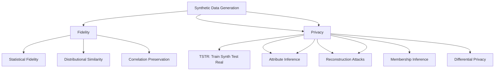

# Synthetic Data Best Practices & Patterns

A comprehensive guide to best practices, design patterns, and common pitfalls in synthetic data generation.

---

## 1. Design Principles

### 1.1 Core Principles



### 1.2 Design Principles

| Principle | Description | Implementation |
|-----------|-------------|----------------|
| **Fidelity First** | Statistical fidelity is prerequisite for utility | Validate distributions before utility |
| **Privacy by Design** | Privacy built-in, not bolted on | DP, PATE, k-anon from start |
| **Utility-Driven** | Optimize for downstream task performance | TSTR/TRTS as primary metrics |
| **Reproducibility** | Fixed seeds, versioned data/models | Seed everything, version data |
| **Minimal Sufficient** | Generate only what's needed | Avoid over-generation |
| **Auditability** | Full lineage, reproducibility | Version data, models, seeds |

---

## 2. Project Setup & Workflow

### 1. Project Structure
```
synthetic-data-project/
├── configs/
│   ├── base_config.yaml
│   ├── model_configs/
│   │   ├── ctgan.yaml
│   │   ├── tvae.yaml
│   │   └── dp_ctgan.yaml
│   └── eval_config.yaml
├── configs/
│   ├── schema.yaml
│   ├── constraints.yaml
│   └── privacy.yaml
├── data/
│   ├── raw/
│   ├── processed/
│   ├── synthetic/
│   └── evaluation/
├── src/
│   ├── data/
│   │   ├── loader.py
│   │   ├── validator.py
│   │   └── profiler.py
│   ├── generation/
│   │   ├── trainer.py
│   │   ├── sampler.py
│   │   └── privacy.py
│   ├── evaluation/
│   │   ├── fidelity.py
│   │   ├── utility.py
│   │   └── privacy.py
│   └── pipeline.py
├── tests/
│   ├── test_fidelity.py
│   ├── test_utility.py
│   └── test_privacy.py
├── configs/
│   └── config.yaml
├── notebooks/
│   └── exploration.ipynb
├── requirements.txt
├── pyproject.toml
├── README.md
└── dvc.yaml / dvc.lock
```

### 2. Configuration Management (YAML)
```yaml
# config.yaml
project:
  name: "synthetic-data-pipeline"
  version: "1.0.0"
  random_seed: 42

data:
  source: "s3://bucket/data/train.parquet"
  target: "s3://bucket/synthetic/"
  schema_path: "configs/schema.yaml"
  constraints_path: "configs/constraints.yaml"

privacy:
  epsilon: 1.0
  delta: 1e-5
  mechanism: "dp-ctgan"  # or "pate", "dp-sgd"
  budget_allocation:
    preprocessor: 0.1
    model: 0.8
    postprocess: 0.1

model:
  type: "ctgan"  # ctgan, tvae, gaussian_copula, dp-ctgan
  epochs: 300
  batch_size: 500
  generator_lr: 2e-4
  discriminator_lr: 2e-4
  generator_dim: [256, 256]
  discriminator_dim: [256, 256]
  pac: 10
  cuda: true

evaluation:
  fidelity_metrics: ["ks", "jsd", "wasserstein", "correlation"]
  utility_metrics: ["tstr", "trts", "downstream_task"]
  privacy_metrics: ["mia", "attribute_inference", "k_anonymity"]
  thresholds:
    fidelity_score: 0.90
    utility_ratio: 0.95
    mia_auc: 0.55
    attr_inf_auc: 0.60

compute:
  device: "cuda"
  batch_size: 500
  epochs: 300
  early_stopping_patience: 20
  gradient_accumulation_steps: 4

mlflow:
  tracking_uri: "http://localhost:5000"
  experiment_name: "synthetic-data-generation"
```

---

## 3. Project Structure with `targets` (Pipeline Orchestration)

### `_targets.R` / `dvc.yaml` / `_targets.py`
```python
# _targets.py (Python targets pipeline)
from targets import target, pipeline

@target
def raw_data():
    return download_raw_data()

@target
def profile_data(raw_data):
    return profile_data(raw_data)

@target
def train_model(raw_data, config):
    return train_synthesizer(raw_data, config)

@target
def generate_synthetic(model, n_samples):
    return generate_synthetic(model, n_samples)

@target
def evaluate(synthetic_data, real_data):
    return evaluate_all(synthetic, real)

@target
def deploy(model, synthetic_data):
    deploy_to_registry(model, synthetic_data)

pipeline = pipeline(
    raw_data,
    profile_data,
    train_model,
    generate_synthetic,
    evaluate,
    deploy
)
```

---

## 3. Data Profiling & Pre-Generation Analysis

### 1. Data Profiling Pipeline
```python
class DataProfiler:
    def __init__(self, df: pd.DataFrame):
        self.df = df
        self.profile = {}
    
    def profile(self):
        self.profile['overview'] = self._overview()
        self.profile['missing'] = self._missingness()
        self.profile['distributions'] = self._distributions()
        self.profile['correlations'] = self._correlations()
        self.profile['outliers'] = self._outliers()
        self.profile['cardinality'] = self._cardinality()
        return self.profile
    
    def _overview(self):
        return {
            'n_rows': len(self.df),
            'n_cols': len(self.df.columns),
            'memory_mb': self.df.memory_usage(deep=True).sum() / 1e6,
            'dtypes': self.df.dtypes.value_counts().to_dict()
        }
    
    def _missingness(self):
        return {
            'total_missing': self.df.isnull().sum().sum(),
            'per_column': self.df.isnull().sum().to_dict(),
            'pct_missing': (self.df.isnull().mean() * 100).to_dict()
        }
    
    def _distributions(self):
        numeric = self.df.select_dtypes(include=[np.number])
        return {
            col: {
                'mean': self.df[col].mean(),
                'std': self.df[col].std(),
                'skew': self.df[col].skew(),
                'kurtosis': self.df[col].kurtosis(),
                'quantiles': self.df[col].quantile([0.01, 0.05, 0.25, 0.5, 0.75, 0.95, 0.99]).to_dict()
            } for col in self.df.select_dtypes(include=[np.number]).columns
        }
    
    def _correlations(self):
        numeric = self.df.select_dtypes(include=[np.number])
        if len(numeric.columns) > 1:
            return self.df[numeric.columns].corr().to_dict()
        return {}
    
    def _outliers(self):
        numeric = self.df.select_dtypes(include=[np.number])
        outliers = {}
        for col in numeric.columns:
            Q1 = self.df[col].quantile(0.25)
            Q3 = self.df[col].quantile(0.75)
            IQR = Q3 - Q1
            outliers = ((self.df[col] < (Q1 - 1.5*IQR)) | (self.df[col] > (Q3 + 1.5*IQR))).sum()
            outliers[col] = int(outliers)
        return outliers
```

---

## 3. Constraints & Business Logic

### 1. Constraint Types & Implementation
```python
from sdv.constraints import (
    Unique, GreaterThan, LessThan, ScalarRange,
    GreaterThan, LessThan, Inequality, ScalarInequality,
    CustomConstraint
)

# Built-in constraints
metadata.add_constraint(Unique(column='user_id'))
metadata.add_constraint(ScalarRange(column='age', low=0, high=120))
metadata.add_constraint(GreaterThan(column='end_date', reference='start_date'))
metadata.add_constraint(ScalarInequality(low='start_salary', high='end_salary'))

# Custom business rules
class BusinessRule(CustomConstraint):
    def _get_columns(self):
        return ['status', 'amount']
    
    def _is_valid(self, data, **kwargs):
        # Business logic: refunds only for completed orders
        return (data['status'] != 'refunded') | (data['amount'] < 0)

metadata.add_constraint(BusinessRule())

# Temporal constraints
class TemporalOrder(CustomConstraint):
    def _get_columns(self):
        return ['start_date', 'end_date']
    
    def _is_valid(self, data, **kwargs):
        return (data['start_date'] <= data['end_date']).all()

# Conditional constraints
class ConditionalConstraint(CustomConstraint):
    def _get_columns(self):
        return ['status', 'refund_amount']
    
    def _is_valid(self, data, **kwargs):
        # Refunds only for completed orders
        return (data['status'] != 'refunded') | (data['refund_amount'] > 0)

# Cross-table constraints
class ReferentialIntegrity(CustomConstraint):
    def _get_columns(self):
        return ['user_id', 'order_id']
    
    def _is_valid(self, data, **kwargs):
        # Foreign key validity
        return data['user_id'].isin(valid_user_ids).all()
```

---

## 3. Privacy-Preserving Patterns

### 1. Differential Privacy Patterns

#### 1.1 DP-SGD Pattern
```python
# Opacus DP-SGD Pattern
from opacus import PrivacyEngine
from opacus.accountants import RDPAccountant

privacy_engine = PrivacyEngine(
    accountant="rdp",  # RDP accountant (tighter bounds)
    secure_mode=False
)

model, optimizer, data_loader = privacy_engine.make_private(
    module=model,
    optimizer=optimizer,
    data_loader=train_loader,
    noise_multiplier=1.0,      # σ
    max_grad_norm=1.0,         # C (clipping norm)
    poisson_sampling=True      # Poisson subsampling
)

# Training loop with privacy accounting
for epoch in range(epochs):
    for data, target in data_loader:
        optimizer.zero_grad()
        output = model(data)
        loss = loss_fn(output, target)
        loss.backward()
        optimizer.step()
    
    # Get privacy spent
    epsilon = privacy_engine.get_epsilon(delta=1e-5)
    print(f"Epoch {epoch}: ε = {epsilon:.2f}")
```

### 2. PATE Pattern
```python
# PATE: Private Aggregation of Teacher Ensembles
class PATEFramework:
    def __init__(self, n_teachers=10, noise_scale=1.0, n_classes=10):
        self.n_teachers = n_teachers
        self.noise_scale = noise_scale
        self.teachers = [self._train_teacher(i) for i in range(n_teachers)]
    
    def _train_teacher(self, i):
        # Train on disjoint data partition
        teacher_data = self.partition_data(i)
        return train_teacher(teacher_data)
    
    def predict(self, x):
        # Get votes from all teachers
        votes = np.array([t.predict(x) for t in self.teachers])
        
        # Add Laplace noise
        counts = np.bincount(votes, minlength=n_classes)
        noise = np.random.laplace(0, self.noise_scale, n_classes)
        noisy_counts = counts + noise
        
        return np.argmax(noisy_counts)

# Confident Aggregation
def confident_aggregate(votes, threshold=200):
    """Only answer if consensus is strong enough"""
    counts = np.bincount(votes, minlength=n_classes)
    max_votes = counts.max()
    if max_votes >= threshold:
        return np.argmax(votes)
    return None  # Abstain
```

### 3. PATE-GAN Pattern
```python
# PATE-GAN: PATE + GAN
class PATEGAN:
    def __init__(self, n_teachers=10, epsilon=1.0, delta=1e-5):
        self.n_teachers = n_teachers
        self.epsilon = epsilon
        self.teachers = [Discriminator() for _ in range(n_teachers)]
        self.generator = Generator()
        self.student = Discriminator()
    
    def train_step(self, real_data):
        # 1. Teachers vote on real data
        teacher_votes = [t(real_data) for t in self.teachers]
        
        # 2. Noisy aggregation
        agg_votes = self.private_aggregate(teacher_votes)
        
        # 3. Student learns from noisy labels
        student_loss = self.student_loss(real_data, agg_votes)
        
        # 4. Generator fools student
        gen_loss = self.generator_loss()
        
        return losses
```

---

## 4. Evaluation Patterns

### 1. Comprehensive Evaluation Pipeline
```python
class SyntheticDataEvaluator:
    def __init__(self, thresholds=None):
        self.thresholds = thresholds or {
            'fidelity_score': 0.90,
            'utility_ratio': 0.95,
            'mia_auc': 0.55,
            'attr_inf_auc': 0.60,
            'k_anonymity': 5
        }
    
    def evaluate(self, real_data, synthetic_data, metadata=None):
        results = {}
        
        # 1. Fidelity
        results['fidelity'] = self.evaluate_fidelity(real_data, synth_data)
        
        # 2. Utility
        results['utility'] = self.evaluate_utility(real_train, synth_train, real_test)
        
        # 3. Privacy
        results['privacy'] = self.evaluate_privacy(real_train, synth_train)
        
        # 4. Overall
        results['passed'] = self._check_thresholds(results)
        results['summary'] = self.generate_summary(results)
        
        return results
    
    def evaluate_fidelity(self, real, synth):
        return {
            'ks_statistics': self.ks_test(real, synth),
            'js_divergence': self.js_divergence(real, synth),
            'wasserstein': self.wasserstein_distance(real, synth),
            'correlation_diff': self.correlation_diff(real, synth),
            'c2st_auc': self.c2st_auc(real, synth)
        }
    
    def evaluate_utility(self, real_train, synth_train, real_test):
        # TSTR: Train on Synthetic, Test on Real
        synth_model = model_class().fit(synth_X, synth_y)
        tstr_score = model.score(X_test_real, y_test_real)
        
        # TRTS: Train Real, Test Synthetic
        real_model = model_class().fit(X_real_train, y_real_train)
        trts_score = real_model.score(X_synth_test, y_synth_test)
        
        return {
            'tstr_score': tstr_score,
            'trts_score': trts_score,
            'utility_ratio': tstr_score / real_baseline_score
        }
```

---

## 4. Deployment Patterns

### 1. Model Serving
```python
# FastAPI + BentoML / vLLM / Triton
from fastapi import FastAPI
from pydantic import BaseModel
import joblib

app = FastAPI()

class GenerationRequest(BaseModel):
    prompt: str
    n_samples: int = 1000
    conditions: Optional[Dict] = None

class GenerationResponse(BaseModel):
    data: List[Dict]
    metadata: Dict

@app.post("/generate", response_model=GenerationResponse)
async def generate(request: GenerationRequest):
    synthetic = synthesizer.sample(
        n_samples=request.n_samples,
        conditions=request.conditions
    )
    return GenerationResponse(
        data=synthetic.to_dict('records'),
        metadata={"n_samples": len(synthetic), "timestamp": datetime.now()}
    )

# Batch endpoint
@app.post("/generate/batch")
async def generate_batch(requests: List[GenerationRequest]):
    return [generate(r) for r in requests]
```

### 2. BentoML
```python
import bentoml
from bentoml.io import JSON, NumpyNdarray

@bentoml.service(
    resources={"cpu": "2", "memory": "4Gi"},
    traffic={"timeout": 30},
)
class SyntheticDataService:
    def __init__(self):
        self.model = bentoml.sklearn.get("synthetic_generator:latest").to_runner()
    
    @bentoml.api(input=JSON(), output=JSON())
    async def generate(self, input_data: dict) -> dict:
        n_samples = input_data.get("n_samples", 1000)
        conditions = input_data.get("conditions")
        synthetic = self.model.generate(n_samples, conditions)
        return {"data": synthetic.to_dict('records')}

# Build: bentoml build
# Deploy: bentoml containerize
```

### 2. Triton Inference Server
```python
# Triton Inference Server config
# model_repository/
#   synthesizer/
#     1/
#       model.py
#     config.pbtxt

# config.pbtxt
name: "synthesizer"
platform: "python"
max_batch_size: 128
input [
  { name: "n_samples", data_type: TYPE_INT32, dims: [1] },
  { name: "conditions", data_type: TYPE_STRING, dims: [-1] }
]
output [
  { name: "data", data_type: TYPE_STRING, dims: [-1] }
]

# model.py
import json
import numpy as np
import triton_python_backend_utils as pb_utils

class TritonPythonModel:
    def initialize(self, args):
        self.model = joblib.load("synthesizer.pkl")
    
    def execute(self, requests):
        responses = []
        for request in requests:
            n_samples = pb_utils.get_input_tensor_by_name(request, "n_samples").as_numpy()[0]
            conditions = pb_utils.get_input_tensor_by_name(request, "conditions").as_numpy()
            synthetic = self.model.generate(n_samples, conditions)
            output_tensor = pb_utils.Tensor("data", json.dumps(synthetic.to_dict('records')).encode())
            responses.append(pb_utils.InferenceResponse(output_tensors=[output_tensor]))
        return responses
```

---

## 3. Monitoring & Observability

### 1. Data Quality Monitoring
```python
from evidently.report import Report
from evidently.metric_preset import DataDriftPreset, DataQualityPreset
from evidently.test_suite import TestSuite
from evidently.tests import *

# Data drift monitoring
drift_report = Report(metrics=[DataDriftPreset()])
drift_report.run(reference_data=train_data, current_data=new_data)
drift_report.save_html("drift_report.html")

# Test suite
suite = TestSuite(tests=[
    TestNumberOfDriftedColumns(threshold=0.1),
    TestColumnDrift(column='age', stattest='ks', threshold=0.05),
    TestColumnDrift(column='income', stattest='ks', threshold=0.05),
    TestNumberOfMissingValues(),
    TestColumnValueMinMax(column='age', min=0, max=120),
    TestColumnValueMinMax(column='income', min=0, max=1000000),
])
suite.run(reference_data=train_data, current_data=new_batch)
suite.save_html("test_suite.html")
```

### 2. Drift Detection
```python
def detect_drift(reference_data, current_data, threshold=0.1):
    """Detect semantic drift in synthetic data"""
    from scipy.spatial.distance import cdist
    from scipy.stats import ks_2samp
    
    # MMD (Maximum Mean Discrepancy)
    def mmd(x, y, kernel='rbf', gamma=1.0):
        from sklearn.metrics.pairwise import rbf_kernel
        XX = rbf_kernel(x, x, gamma=1.0)
        YY = rbf_kernel(y, y, gamma=1.0)
        XY = rbf_kernel(x, y, gamma=1.0)
        return XX.mean() + YY.mean() - 2*XY.mean()
    
    # Feature-wise KS test
    drift_results = {}
    for col in numeric_cols:
        stat, p = ks_2samp(ref[col], curr[col])
        if p < 0.05:
            drift_results[col] = {'stat': stat, 'p': p, 'drift': True}
    
    # MMD (Maximum Mean Discrepancy)
    mmd = mmd_rbf(ref_data, curr_data)
    
    return {
        'drift_detected': any(r['drift'] for r in drift_results.values()),
        'drift_details': drift_results,
        'mmd': mmd
    }
```

---

## 2. Continuous Improvement

### 1. Feedback Loops
```python
class ContinuousImprovement:
    def __init__(self):
        self.performance_history = []
        self.drift_detector = DriftDetector()
    
    def monitor_and_retrain(self, new_data, model, threshold=0.05):
        # Detect drift
        drift_score = self.drift_detector.detect(new_data)
        
        if drift_score > threshold:
            # Trigger retraining
            new_model = self.retrain(new_data)
            self.deploy(new_model)
            
            # Log
            self.log_retraining(drift_score, new_model_version)
```

### 2. Automated Retraining Pipeline
```yaml
# .github/workflows/retrain.yml
name: Auto-Retrain

on:
  schedule:
    - cron: '0 2 * * 0'  # Weekly
  workflow_dispatch:
    inputs:
      force:
        type: boolean
        default: false

jobs:
  retrain:
    runs-on: ubuntu-latest
    steps:
      - uses: actions/checkout@v4
      - name: Setup Python
        uses: actions/setup-python@v5
        with: {python-version: '3.11'}
      - name: Install dependencies
        run: uv sync --all-extras
      - name: Check drift
        run: python check_drift.py --threshold 0.05
      - name: Retrain if needed
        if: steps.drift.outputs.drift_detected == 'true'
        run: |
          python train.py --retrain
          python evaluate.py
          python deploy.py
```

---

## 11. Quick Reference Card

| Task | Command / Code |
|------|----------------|
| **Quick synthetic data** | `sdv.single_table.GaussianCopulaSynthesizer(metadata).fit(df).sample(1000)` |
| **CTGAN** | `CTGANSynthesizer(metadata, epochs=300).fit(df).sample(10000)` |
| **CTGAN + DP** | `DPCTGAN(epsilon=1.0).fit(df).sample(10000)` |
| **Time series** | `NeuralForecast(models=[NBEATS, NHITS], freq='H').fit(df)` |
| **Evaluate** | `evaluate_quality(real, synth, metadata)` |
| **TSTR** | `train_synth_test_real(synth, real)` |
| **Privacy** | `membership_inference_attack(model, train, test, synth)` |
| **Privacy (DP)** | `opacus.PrivacyEngine().make_private(module, optimizer, loader, noise_multiplier=1.0)` |
| **Quantize** | `quantize_dynamic(model, {nn.Linear}, dtype=torch.qint8)` |
| **Serve** | `vllm serve model --tensor-parallel-size 2` |

---

## Key Takeaways

1. **Use `uv`** for fast, reproducible package management
2. **Pipelines over scripts** - Use `targets`/`dvc`/`dagster` for reproducibility
3. **Privacy first** - Budget ε, use DP-SGD, PATE, or Private GANs
4. **Evaluate holistically** - Fidelity + Utility + Privacy
5. **Monitor in production** - Drift detection, performance tracking, automated retraining
6. **Version everything** - Code, data, models, environments (DVC + MLflow)
9. **Explain your model** - SHAP, permutation importance, PDP
10. **Automate** - CI/CD, retraining pipelines, drift detection

---

*Last updated: 2024-11-05*
*Part of: Synthetic Data Knowledge Base*