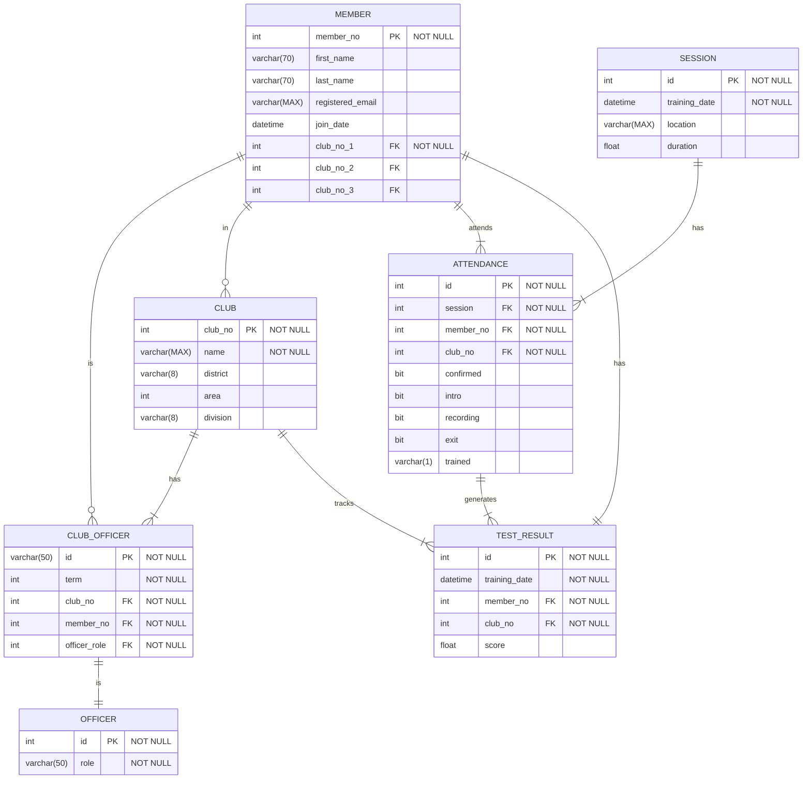

# TLI Data Initiative

## Preface

In order to ensure that the statistics surrounding biannual TLI training, this is a diagram for a relational database using multiple tables to allow for the registration and validation of training sessions and ensuring a record of attendees. This data will enable us to update training results quicker and get the reports out to the clubs quicker.

This is a diagram of the recommended tables that will be created for this project.

## Table Notes

### Officer

1. role should have the following entries
	- President
	- Vice President Education
	- Vice President Membership
	- Vice President Public Relations
	- Sergeant-At-Arms
	- Secretary
	- Treasurer

### Club

1. The district field can allow us to update club information for out of district clubs that attend our training sessions. This can be updated after the fact and can be used to create reports for other districts.

### Club_Officer

1. The term should be the year that the term starts, so current officers would have a value of 2026 in this field. On July 1, the new officers will be 2027

### Member

1. The member should **ALWAYS** have at least one club_id in the row. The remainder can be nullable 

### Session

1. The bit flag on in_person indicates if it is a in person or a virtual session
2. duration is a float to indicate the number of hours scheduled for the session.

### Attendance

1. The bit flags here are to convert a registration into a attendance record and approval of the training.
2. trained, as a VARCHAR(1), is intended to be 'Y' or 'N' to indicate if training is considered complete.

## Additional Notes

I would recommend and can design a different page to update trained status which would then update the Attendance table with confirmation of attendance to each section of training and completion of training.

## Meeting 19 November 2026

We should go with a blend of Jacquie's and Davin's forms. Davin should be able to learn enough Javascript and see what ORMs are available. We really need to know what kind of JS that Wix supports. That will enable us to determine what is available. 

Back end, I will design the tables and outline the queries. I also need to reach out for the space.

[TLI Registraion Page](https://www.d218toastmasters.org/TLI-Registration) 